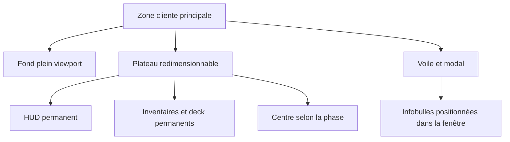
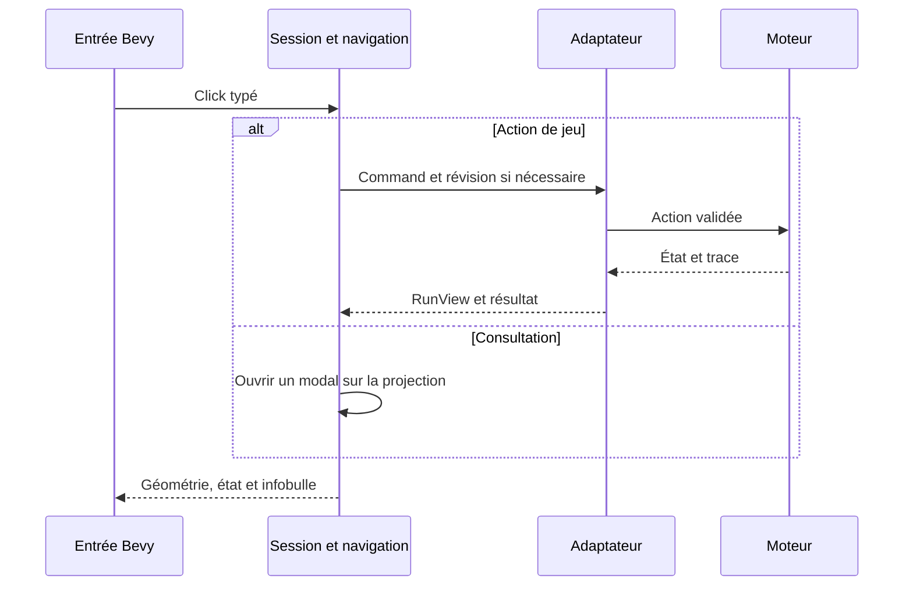

# Ante — guide de conversion des interfaces

Ce guide relie les comportements relevés dans [la bibliothèque legacy](UI_LEGACY_GUIDE.md) aux responsabilités du moteur et aux composants Bevy du client expérimental. Lire les deux sections pertinentes avant d'implémenter une interaction. La version de référence locale est Balatro 1.0.1o.

## Couches et données

Le moteur possède la partie, le hasard, les actions légales, les capacités et les objectifs. `EngineRun` traduit `Command`, journalise via le client et fournit une projection `RunView` sans tirage aléatoire. Les actions indexées vérifient la révision. `Playback` lit une trace déjà calculée, avec la projection avant action tant que l'animation la représente. La navigation, les modaux et l'onglet du deck appartiennent à la présentation. Ouvrir le deck ou les réglages suspend la présentation et n'exécute aucune action de jeu.

## Contrat visuel

Comparer à largeur et hauteur clientes identiques. Mesurer les positions et les tailles en fractions de la zone cliente. Dans les captures 1920×1080, le HUD commence près de 5 % de la largeur et occupe environ 22 %. Les inventaires s'alignent à sa droite, en haut. Le centre reste libre jusqu'au contenu de phase et le deck s'ancre en bas à droite, avec les tags à sa droite. La vue Full Deck occupe environ 83 % de la largeur et 84 % de la hauteur cliente. Utiliser des tuiles et une échelle uniforme pour les cartes et textes. Les ancres des régions peuvent absorber l'écart de format. Les fonds et voiles couvrent les bords du viewport.

Les contrôles partagent la palette et des hitboxes stables. Pour cette adaptation, l'assombrissement indique le survol et l'appui sans déplacer ni redimensionner le bouton. Les panneaux gardent leurs contours utiles. Les zones d'inventaire présentent les cartes détenues sur un fond translucide. Leur capacité est une donnée, jamais un nombre de cases décoratives. Le modal intercepte les clics du plateau. L'infobulle est bornée à la fenêtre et ne capte pas les clics. Les atlas sont facultatifs et chargés localement. Le profiler F3 conserve sa propre fenêtre.

## Matrice de conversion

| Référence | Composition et entrée Ante | Données et action | Recette et écart |
| --- | --- | --- | --- |
| Menu / profils | `main_menu`, navigation principale et profil local | Graine, run en mémoire, découvertes | Play, Options, Collection, Quit. Les profils multiples et les déblocages complets restent à cartographier. |
| Run Setup / challenges | Modal `deck_select`, sélecteurs, bouton Seeded Run | `RunConfig`, saisie et presse-papiers, decks Rouge/Bleu et White Stake | Tester seed vide, numérique, alphanumérique, Paste, annulation et Continue. Les autres decks, stakes et challenges sont des écarts. |
| Réglages / pause | Voile, pages de réglages, pause, Run Info | Navigation, vitesse, VSync, sauvegarde des paramètres du client selon support | Échap et Back ramènent au bon écran. La pause conserve la partie et le score animé. |
| Choix de blind | Centre du plateau, jetons et aperçu de tag | `RunView.blinds`, Select, Skip validé et révision | Small puis Big puis Boss. Vérifier objectifs et resets de skip par ante. |
| Main / score | Centre et actions Play Hand, Rank/Suit, Discard. HUD et animation de trace | Main, sélection, tri moteur, score, compteurs | Vérifier sélection après tri et lecture du score aux trois vitesses. Le drag reste distinct. |
| Récompense / boutique | Centre remplacé, inventaires visibles | Cash Out, offres, achats, ventes, usages, reroll, Next Blind | Vérifier l'encaissement unique et la transition. Redeem, achat de carte à jouer, ouverture de pack et choix de cible sont branchés sur les actions légales. |
| Possessions / tags | Deux zones d'inventaire et pile à droite du deck | Cartes détenues, capacités, tags du moteur en ordre d'acquisition | Tester capacités variables et deux skips. Les tags en attente restent visibles jusqu’à leur déclenchement. |
| Deck / infobulles | Overlay Full Deck et Remaining, rangées et compteurs | Pioche, main et défausse en lecture seule. Type, édition, amélioration, sceau | La vue restante ne révèle pas l'ordre de pioche. Back restaure la sélection. Tester atlas absent. |
| Collection | Hub et sous-vues paginées | Catalogue et découvertes du profil | Les entrées non découvertes gardent leur anonymat. Étendre chaque catégorie avec son contrat. |
| Victoire / défaite | Modal sur le plateau. Résultat, graine et stats disponibles | Victoire à l'ante 8, résultat courant, mode Endless et limite | Main Menu, New Run, Endless Mode. Annuler New Run revient au résultat. La défaite en Endless garde la victoire de l'ante 8. |

## Recette Windows

Lancer la version Release avec puis sans `--steam-textures`. Comparer à résolution égale les captures de sélection, main, shop, Full Deck et victoire. Ensuite tester 1920×1080, une fenêtre étroite, un format ultralarge et le DPI à 125 %. Relever pour chaque phase les écarts de position, taille, palette, focus, interaction et comportement à la souris. Vérifier qu'un modal couvre le viewport et que le profiler reste indépendant. Les effets de fond et le CRT de la référence restent des écarts visuels.

La suite automatisée couvre les états moteur et client, le déterminisme, les contrôles et la projection. Une comparaison visuelle réelle reste une vérification distincte. Pour appliquer le processus, lire [ante-legacy-to-bevy](../.skills/ante-legacy-to-bevy/SKILL.md) puis [ante-ui-parity](../.skills/ante-ui-parity/SKILL.md).

## Application au plateau partagé

1. **Relier le centre à la phase.** `render` conserve un `RunBoard` pour l'identifiant de run actif. Le fond et les entités d'ancrage sont stables. La phase change le contenu central. Le HUD met à jour ses entités texte, les zones de possession réaffichent leur contenu selon les cartes et les commandes légales, et la pile de tags ne change que quand la liste moteur change. Le changement de seed ou de run crée un nouveau plateau.
2. **Utiliser la projection visible.** Durant la trace, les régions lisent la projection précédente. Chips et Mult lisent le pas courant. Une fois la trace terminée, elles lisent le nouvel état. Le calcul et les sorties aléatoires restent dans le moteur. Le tri Rank/Suit est une commande moteur qui conserve les cartes sélectionnées.
3. **Brancher les modaux sur la couche d'overlay.** Deck Inspect choisit Remaining au départ pendant le jeu de la main et Full Deck ailleurs. Full Deck regroupe pioche, main et défausse. Remaining lit les cartes en pioche et les trie pour l'affichage. Le tri des lignes n'expose pas leur ordre de tirage. Les comptes de base proviennent de la projection. Les comptes effectifs de modifications complexes restent à rapprocher de la référence.
4. **Traiter les cas terminaux au-dessus du plateau.** Le modal lit le statut de victoire enregistré par le moteur. New Run conserve le résultat comme écran de retour. Endless poursuit la run à l'encaissement. Au-delà de la capacité de score, le dernier résultat reste lisible et garde la victoire de l'ante 8. La commande historique `--one-ante` conserve la recette de la graine `0`.

## Écarts à vérifier sur les captures

| Surface | Points de comparaison | Écarts connus ou validation à faire |
| --- | --- | --- |
| Choix de blind / main / boutique | Alignement du HUD et des zones, hauteur des jetons, largeur du centre, deck et tags | Proportions comparées au relevé. Le fond est statique et les captures du rendu final restent à prendre. |
| Full Deck | Enveloppe du modal, compteurs, ordre couleur/rang, rangées et back | L'affichage adapte le recouvrement au nombre de cartes. Vérifier plusieurs copies d'un même rang et les infobulles à droite. |
| Victoire | Titre, lignes de statistiques, deux actions sur une rangée, Endless en dessous | Les stats affichées sont celles que l'adaptateur collecte. L'animation et les éléments décoratifs du modal legacy restent des écarts. |
| Multiformat | Bords de la zone cliente et voile, hauteur et police, zones de clics | La géométrie plein viewport est testée. La recette visuelle et les entrées réelles restent à vérifier à taille et DPI correspondants. |

## Contrats à réutiliser

| Besoin | Point d'entrée Bevy | Vérification |
| --- | --- | --- |
| Bouton et panneau | `components::tiles::tile_button`, `tile_optional`, `menu_button`, `panel` | Un bouton inactif n'émet aucun `Click`. Survol et appui laissent le `Node` et le `UiTransform` stables. |
| Navigation et focus | `Navigation`, `Page` et `process_clicks` | Revenir à la phase appelante. À l'ouverture d'un modal, le voile intercepte les clics et la navigation filtre les actions de partie. |
| Mesures et ancres | `components::tiles::viewport_fit`, `fit_room`, `RunBoard` | Le canvas couvre la fenêtre à échelle uniforme. Comparer les centres et bords des zones après redimensionnement. |
| Images et police | `Atlases` et `services::assets::catalog::load` | Charger depuis le chemin local validé. Les silhouettes, libellés et textes de secours permettent d'utiliser le même contrôle sans atlas. Les vouchers, les packs et l’enseigne statique utilisent les atlas locaux. |
| Métadonnées contextuelles | `tooltip::attach`, `Tip::currently` et projection du moteur | À partir du même type de carte, vérifier une offre, un objet détenu et une entrée inconnue. Comparer les couleurs Balatro (chance en vert, argent en jaune, valeurs et comptes en orange) et les lignes « Currently ». Tester près des quatre bords et après fermeture d'un modal. |
| Trace et résultat | `EngineRun::apply_traced`, `Playback` et tuiles de score | Les trois vitesses, Passer et la consultation du deck conservent l'état confirmé et la suite aléatoire. |

## Aperçu et contenus de boutique

Le HUD lit `RunView.selected_hand` pour le nom, le niveau et la base Chips × Mult. La trace prend le relais pour les valeurs de résolution. Poker Hands lit les niveaux et compteurs depuis le même planétarium. Royal Flush est un libellé de reconnaissance et partage le niveau de Straight Flush. Les mains avancées apparaissent dans la liste après avoir été jouées.

Redeem associe un identifiant de voucher à la révision de la vue. Les prix des offres gratuites viennent de la boutique du moteur. L’achat retire uniquement l’offre concernée. Les offres courantes, vouchers possédés et prix se consultent séparément. La collection pagine les 150 jokers, 32 vouchers et 24 tags et garde la découverte dans le profil local. La progression de carrière des déblocages reste un écart.

Les packs achetés reviennent à la boutique. Un pack gratuit ouvert par un tag rend la main au choix de blind ou au pack gratuit suivant. Vérifier le choix, l’application d’une cible, Skip, la pile de tags restante et la reprise après snapshot. Les choix de packs utilisent la même échelle de carte que la boutique et construisent leur infobulle à partir de la description de l'objet; vérifier le rendu en jeu. L'achat de cartes à jouer utilise encore un contrôle textuel provisoire. Vérifier en priorité l'espace de boutique quand plusieurs vouchers et des cartes supplémentaires sont proposés.

Le mouvement de survol est partagé entre la main, la boutique, les packs, les possessions et les cartes de l'inspecteur de deck. Les cartes débuffées de la main et du deck reçoivent une croix rouge et une teinte rouge translucide. Les cartes de la main et du deck affichent aussi un badge de sceau. Les effets des sceaux sont fournis par le moteur expérimental, mais leur validation détaillée en jeu reste à faire. Le clic gauche sur une possession ouvre son panneau d'actions. Un déplacement pendant l'appui glisse la carte dans sa rangée. Le dépôt d'un Joker réenregistre les effets dans l'ordre confirmé par la simulation.

## Client modulaire et recette des offres

Sous `crates/ante-app/src`, `main.rs` et `lib.rs` sont les points d'entrée. `app/` regroupe la session, la navigation, la présentation et la lecture du score. `screens/` contient la composition des écrans. `components/` rassemble les contrôles réutilisables, les cartes, le thème et les infobulles. `services/` contient les ressources visuelles, le profil, le stockage et les diagnostics.

Le système de session applique seul les commandes au pilote. Les écrans lisent `RunView` et la lecture de score reçoit une trace du même passage moteur. L'aperçu de pioche et la sélection d'une offre restent côté présentation.

`components/tiles.rs` ajuste le canevas de 22 × 12,9 unités (`CANVAS`) et centre la salle dans chaque écran (`presentation::room_node`). `CARD_WIDTH`, `CARD_HEIGHT` et `card_px()` donnent la taille dessinée d'une carte (0,95 × `CARD_W`, `CARD_H`) ; `spread_x` reprend `align_cards` pour les Jokers, les consommables et les offres. `screens/run/` (`board.rs`, `hud.rs`, `blind.rs`, `deck.rs`) place le HUD, les zones Jokers et consommables, le deck (pile de dos selon les cartes restantes) et le panneau de boutique en unités. `screens/shop/offer.rs` suit `G.UIDEF.shop` (`shop_box`, `offer_area`, `price_tag`, `offer_buttons`) et `components/cards.rs` les boutons Sell et Use (`tiles::card_button`, dans `components/tiles/buttons.rs`). La carte d'inventaire sélectionnée reçoit `GlobalZIndex(100)` tant qu'elle l'est, sous les overlays (150 et plus) ; l'offre sélectionnée passe devant ses voisines. La ligne de l'enseigne est une formulation propre à Ante, le texte d'origine étant de la localisation.

`components/pixel_rect.rs` fournit `PixelBox` : un `UiMaterial` avec un WGSL écrit pour Ante (`pixel_rect.wgsl`) qui reproduit les coins en escalier, le relief et l'ombre. Il fournit aussi `DynUi` et `DynRole`, qui suivent les couleurs `G.C.DYN_UI` selon la phase et le blind. `tile_button`, `card_button`, le HUD, la boutique, les étiquettes de prix et les zones de cartes l'utilisent. Les observateurs de bouton colorent la boîte au survol et à la pression.

`components/background.rs` branche le shader `background` importé sur un calque plein canevas derrière la salle. Sans ce shader, le calque reste un aplat de la couleur C.

`services/assets/ui_text.rs` lit dans `localization/en-us.lua` une liste fermée de clés (`ph_improve_run`, `ante_x_voucher`), par motif et sans exécuter de Lua, avec une formulation de secours propre à Ante.

Réglages à tester en jeu :
- `LOVE_GAMMA` (`services/assets/shaders.rs`) : gamma des shaders d'origine convertis (fond, éditions) ; plus haut assombrit.
- `UI_GAMMA` (`components/pixel_rect.rs`) : gamma des couleurs plates des boîtes ; plus haut assombrit.
- `DECK_STACK_SCALE` et `DECK_UNDER_SHADE` (`screens/run/board.rs`) : étalement de la pile du deck et gris des dos sous la carte du dessus.
- `SHOP_ROW_GAP` et `PRICE_TAG_OVERLAP` (`screens/shop.rs`) : écart entre les deux rangées de la boutique et descente de l'étiquette de prix derrière la carte.

Pendant un blind, `row_blind` affiche la boîte de `create_UIBox_HUD_blind` (nom, règle, jeton du blind, cible et récompense). Les boutons de main suivent `create_UIBox_buttons`, avec la boîte Sort Hand contournée (`PixelBox::outline`). Le relief et l'ombre étant dessinés dans la boîte, leur hauteur est ajoutée au padding bas pour que le texte reste centré.

Les boutons, panneaux et modales ont `flex_shrink: 0` : une colonne qui déborde ne les écrase plus. La grille de la collection ne passe plus à la ligne. Les tailles de police sont arrondies au pixel physique entier (`snap_font_size`) et réajustées au redimensionnement ; l'ancien calage sur la grille de glyphes réduisait d'un tiers le petit texte à 1080p. Les infobulles sont placées au pixel physique entier, avec 12 px de marge latérale (`PANEL_SIDE_PADDING`) pour que le retour à la ligne ne change pas quand elles bougent. F5 n'existe plus : le VSync se règle dans les Settings.

`text_px` utilise un em d'une unité (73 px) à l'échelle 1 ; `shadowed_label` et `text_shadow` donnent l'ombre de texte d'origine.

La boutique utilise une zone par groupe, un prix par objet et un contrôle d'achat contextuel. Tester les relances, offres gratuites, lots supplémentaires et refus sur les deux builds. L'infobulle se compose près de l'entité source et recalcule sa position à partir de la taille mesurée. Les métadonnées techniques, l'édition brute et l'état interne des jokers sont propres au build Dev et s'affichent dans un panneau gris clair séparé, sous l'infobulle. La ligne « Currently » vient de `JokerView.current` (`CurrentValue`), calculée par la simulation pour les jokers implémentés et mise en forme par `tooltip::currently_text`.

Comparer les proportions des sprites, la hauteur du panneau, les zones et les interactions aux captures à taille cliente égale. Répéter sur fenêtre étroite et ultralarge. Les éditions des jokers sont dessinées en surcouche avec les shaders d'origine convertis (voir ci-dessous) ; sans shader local, le sprite de base reste seul. La grille de pioche expose les comptes visibles disponibles dans la projection. Vérifier séparément les comptes effectifs et les exceptions liées aux cartes masquées avant de déclarer la parité.

## Rythme, placement et effets

- **Lecture du score** : `app/playback.rs` construit une timeline en secondes de jeu à partir de la trace et du nombre de cartes jouées. Le module `timing` reprend les délais du [guide legacy](UI_LEGACY_GUIDE.md#rythme-du-score-et-vitesse). `Speed` parcourt x0,5 à x128 par doublement ; l'horloge applique l'accélération d'origine. `Stage` (`Intro`, `Scoring`, `Total`, `Discard`) pilote le soulèvement des cartes jouées. La vitesse choisie est enregistrée dans le profil (`game_speed`, version 3), comme `GAMESPEED` dans l'original.
- **Zone de jeu** : la rangée jouée est séparée de la main par `PLAY_AREA_RISE − CARD_HEIGHT` (haut à haut : 3,6 unités). Les cartes qui scorent reçoivent `HoverMotion.raise = HIGHLIGHT_LIFT` pendant `Scoring`. Les tailles de carte d'Ante (120 × 159) diffèrent encore de l'original : à mesurer sur les captures.
- **Trajet des cartes** : `components/travel.rs`. Le client reconstruit la main à chaque changement de vue, donc une carte ne garde pas son entité d'un écran à l'autre. `CardTrail` retient la dernière position à l'écran de chaque `CardKey`. Avant `UiSystems::Layout`, `travel::prepare` choisit le point de départ (position retenue ou `DeckPile`), calcule les délais et replie à largeur nulle une carte piochée qui attend son tour, pour que la main ne s'étale que sur les cartes arrivées. Juste après la mise en page, `travel::place` fait partir la nouvelle carte de son point de départ en décalant son `UiGlobalTransform` et ceux de ses enfants, sans image de retard ; quand la mise en page bouge sous une carte déjà posée, il compense le décalage pour qu'elle glisse au lieu de sauter. `CardTrail` garde aussi la vitesse et le `Pose` de chaque carte (échelle, montée, inclinaison et chute de l'éventail) : une carte reconstruite, par exemple après une sélection, reprend exactement son aspect et son mouvement au lieu de se redresser. `ease_hover` applique ensuite le modèle de vitesse d'origine. Les cartes qui changent de zone partent à 0,1 s de jeu d'intervalle ; pendant l'étape `Discard`, `animate` envoie les cartes jouées vers la défausse hors écran. Après un clic Discard, `travel::detach_discards` (entre `process_clicks` et `render`) détache les cartes qui ont quitté la main : elles deviennent des nœuds racines en position absolue (`DiscardedCard`), survivent à la reconstruction et sont retirées par `retire_discards` à l'arrivée. La pioche qui suit attend leur départ.
- **Flip** : `travel::prepare` pose sur une carte piochée un enfant `CardBack` (le dos lu sur le `DeckPile`). À son départ du deck, `Travel` pince sa largeur jusqu'à zéro puis la rouvre ; `turn_card_backs` masque le dos au milieu du flip.
- **Éventail** : `widgets::Fan::hand` reprend l'inclinaison, la chute et le balancement de `CardArea:align_cards`. `HoverMotion` les lisse comme l'original (`exp(-190·dt)` pour la rotation, `exp(-50·dt)` pour la position). `widgets::fan_hand` le recalcule chaque image sur les cartes présentes : une carte piochée compte dès son départ, une carte défaussée ne compte plus.
- **Survol** : `widgets::card_hover` ajoute `HoverMotion` ; `ease_hover` applique échelle, lift et juice chaque frame, sauf à la carte tenue par le drag.
- **Popups** : `presentation::animate` ajoute un enfant `ScorePopup` coloré à la source du pas et déclenche son juice. Il est au-dessus des cartes (`ScoredCard`) et sous les Jokers détenus (`ScoredJoker`), comme `card_eval_status_text`. `playback::popups` découpe un pas en popups minutés (`Popup::Again`, `Chips`, `Mult`, `XMult`, `Money`) à partir de `ScoreStep.xmult` et `ScoreStep.money` ; `Playback::current_popup` donne celui à afficher.
- **Infobulles** : `tooltip::attach` ancre au-dessus ou en dessous (`TipAnchor::Auto`), `attach_anchored(..., TipAnchor::Left)` à gauche pour la boutique et la vue Deck. `Tip::info` ajoute les encarts latéraux de `components/info.rs` (références, édition, sceau, stickers) ; ils sont placés à gauche du popup principal et centrés sur lui, le panneau debug restant sous le popup.
- **Debug (build Dev)** : Tab affiche `screens/debug.rs`, dont les boutons envoient `Command::Debug(DebugCommand)` par la commande de session. F6 enregistre une capture (`app/capture.rs`, [bibliothèque de captures](CAPTURES.md)).

## Shaders d'origine

L'import Local Assets copie les `.fs` de `services::assets::shaders::SHADER_FILES` s'ils se convertissent. Au démarrage, `shaders::load` lit chaque fichier depuis le lot local ou `--steam-textures`, le réécrit en GLSL 450 (uniforms `extern` dans un bloc de 16 `vec4`, `number`, `Image`, `Texel`, partie vertex retirée, point d'entrée `fragment` qui calcule les coordonnées d'atlas comme `Sprite:draw_shader`), puis naga valide et produit le WGSL. `components::edition::LoveMaterial` est un `UiMaterial` spécialisé par shader ; `edition::overlay` pose un nœud par shader d'édition au-dessus du sprite. Les Jokers (détenus et en boutique) et les cartes jouables (main, zone de jeu, vue Deck) reçoivent l'édition sur la base et sur la face, sous le sceau. Un shader absent ou refusé laisse le sprite seul et l'écrit dans le journal Dev. Le test ignoré `local_installation_shaders_convert` liste la conversion de l'installation locale.

Le paramètre nommé reçoit `min(3·rotation, 1) + temps/28 + tilt_var.amt` (`edition::tilt_amount`) : l'écart du curseur au coin d'une carte survolée, sinon l'inclinaison ambiante par carte (`EditionSeed`). Les uniformes `mouse_screen_pos`, `hovering` et `screen_scale` ne servent qu'à la partie vertex, retirée. Le sceau Gold reçoit `voucher` et les Spectral `booster` (`edition::consumable_look`). Les fonds d'amélioration viennent de `Atlases::card_base_for` et `widgets::playing_card_face` ; une carte Stone n'a pas de face. Restent à faire : `hologram` sur le sprite flottant des légendaires et de The Soul, `voucher` sur Invisible Joker, la composante `juice` du paramètre.

## Infobulles, HUD et packs

- `tooltip::playing_card` construit la bulle d'une carte jouable comme `generate_card_ui` ; les tailles suivent l'original en tuiles (nom `0.55 − 0.004 × longueur`, description 0.32, badge 0.33, ×1.2 pour le type) et la largeur reste fixe (4,2 tuiles) pour que le texte ne change pas de ligne.
- Les tailles de texte modifiées après création passent par `presentation::TextSize` ; ne jamais réinsérer `TextFont`, qui remettrait la police par défaut.
- Le corps du HUD dépasse la salle de 9,25 tuiles en haut et en bas et centre son contenu ; le test `hud_column_fits_the_window` le vérifie.
- `pack_board` pose la boîte du pack (`sparkles::PackRise`, montée de 0,45 s depuis `ROOM.y + 9`) au-dessus de `hand::hand_rows` ; `sparkles::update` porte `Particles` (fill, timer, scale, lifespan, speed, couleurs) pour Arcana et Spectral, fondu d'une seconde. Le RNG des particules est celui de la présentation.

## Audio, salle et dissolution

- **Sons** : `services/assets/sounds.rs` charge les effets autorisés (`SOUND_FILES`) depuis le lot local ou `--steam-textures` et joue les messages `Sfx { name, pitch, volume }` avec les volumes du profil. `app/cues.rs` associe les clics aux sons d'origine (`button`, `cardSlide1/2`, `coin2`, `tarot1`) ; le survol, le départ des cartes, les popups et la dissolution émettent leurs propres `Sfx`.
- **Salle** : `components/room.rs` applique la dérive et la secousse au nœud `Screen`. `travel::place` travaille dans le repère de la salle (`room_frame`), si bien que la secousse ne déclenche aucun trajet de carte.
- **Dissolution** : `components/dissolve.rs` détache les Jokers et consommables qui quittent l'inventaire (`detach_leaving`), pose un calque `dissolve` sur chaque sprite, pilote l'uniform `dissolve` et les couleurs de brûlure, lance les particules puis retire la carte. `advance_time` ne touche pas l'uniform `dissolve`, qui n'est pas un paramètre d'animation.
- **Collection** : `CollectionView::Items(ContentGroup)` couvre toutes les catégories ; `collection_sprite` et `collection_art` choisissent le visuel (atlas, carte de base avec édition ou sceau, jeton de blind).
