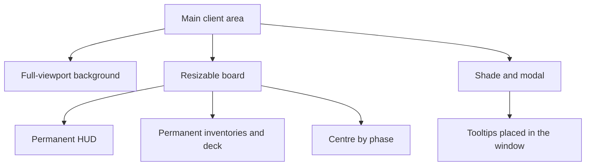
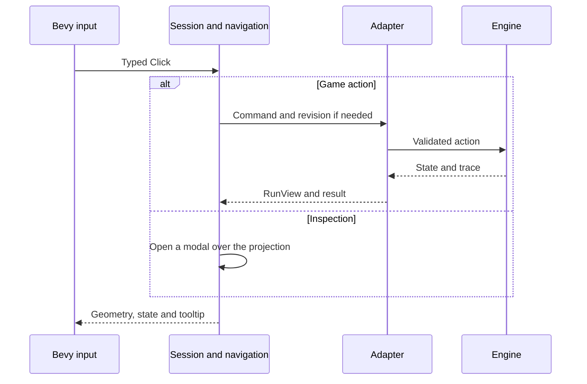

# Ante — interface conversion guide

This guide links the behaviours recorded in [the legacy library](UI_LEGACY_GUIDE.md) to the engine's responsibilities and to the Bevy components of the experimental client. Read both relevant sections before implementing an interaction. The local reference version is Balatro 1.0.1o.

## Layers and data

The engine owns the game, randomness, legal actions, capacities and targets. `EngineRun` translates `Command`, logs through the client and provides a `RunView` projection without drawing randomness. Indexed actions check the revision. `Playback` reads an already computed trace, with the projection from before the action while the animation shows it. Navigation, modals and the deck tab belong to presentation. Opening the deck or the settings pauses presentation and runs no game action.

## Visual contract

Compare at identical client width and height. Measure positions and sizes as fractions of the client area. In the 1920×1080 captures, the HUD starts near 5 % of the width and takes about 22 %. The inventories line up to its right, at the top. The centre stays free down to the phase content and the deck is anchored bottom right, with the tags to its right. The Full Deck view takes about 83 % of the client width and 84 % of its height. Use tiles and a uniform scale for cards and text. Region anchors may absorb the aspect ratio difference. Backgrounds and shades cover the viewport edges.

Controls share the palette and stable hitboxes. In this adaptation, darkening shows hover and press without moving or resizing the button. Panels keep their useful outlines. Inventory areas show the held cards on a translucent background. Their capacity is data, never a number of decorative slots. The modal intercepts board clicks. The tooltip is clamped to the window and does not take clicks. Atlases are optional and loaded locally. The F3 profiler keeps its own window.

## Conversion matrix

| Reference | Ante composition and input | Data and action | Acceptance and gap |
| --- | --- | --- | --- |
| Menu / profiles | `main_menu`, main navigation and local profile | Seed, run in memory, discoveries | Play, Options, Collection, Quit. Multiple profiles and full unlocks remain to be mapped. |
| Run Setup / challenges | `deck_select` modal, selectors, Seeded Run button | `RunConfig`, input and clipboard, Red/Blue decks and White Stake | Test an empty, numeric and alphanumeric seed, Paste, cancel and Continue. Other decks, stakes and challenges are gaps. |
| Settings / pause | Shade, settings pages, pause, Run Info | Navigation, speed, VSync, saving the client settings where supported | Escape and Back return to the right screen. Pause keeps the game and the animated score. |
| Blind choice | Board centre, chips and tag preview | `RunView.blinds`, Select, validated Skip and revision | Small, then Big, then Boss. Check targets and skip resets per ante. |
| Hand / score | Centre and Play Hand, Rank/Suit, Discard actions. HUD and trace animation | Hand, selection, engine sort, score, counters | Check the selection after a sort and score playback at the three speeds. Dragging stays separate. |
| Reward / shop | Centre replaced, inventories visible | Cash Out, offers, purchases, sales, uses, reroll, Next Blind | Check the single cash out and the transition. Redeem, playing card purchase, pack opening and target choice are wired to the legal actions. |
| Possessions / tags | Two inventory areas and a stack right of the deck | Held cards, capacities, engine tags in acquisition order | Test variable capacities and two skips. Pending tags stay visible until they trigger. |
| Deck / tooltips | Full Deck and Remaining overlay, rows and counters | Draw pile, hand and discard read-only. Type, edition, enhancement, seal | The remaining view does not reveal the draw order. Back restores the selection. Test a missing atlas. |
| Collection | Hub and paged sub-views | Catalogue and profile discoveries | Undiscovered entries stay anonymous. Extend each category with its contract. |
| Win / loss | Modal over the board. Result, seed and available stats | Win at ante 8, current result, Endless mode and limit | Main Menu, New Run, Endless Mode. Cancelling New Run returns to the result. A loss in Endless keeps the ante 8 win. |

## Windows acceptance

Run the Release build with and then without `--steam-textures`. Compare the selection, hand, shop, Full Deck and win captures at equal resolution. Then test 1920×1080, a narrow window, an ultrawide size and 125 % DPI. For each phase, record the gaps in position, size, palette, focus, interaction and mouse behaviour. Check that a modal covers the viewport and that the profiler stays independent. The reference's background effects and CRT remain visual gaps.

The automated suite covers engine and client states, determinism, controls and the projection. A real visual comparison remains a separate check. To apply the process, read [ante-legacy-to-bevy](../.skills/ante-legacy-to-bevy/SKILL.md) then [ante-ui-parity](../.skills/ante-ui-parity/SKILL.md).

## Applying it to the shared board

1. **Tie the centre to the phase.** `render` keeps one `RunBoard` for the active run id. The background and anchor entities are stable. The phase changes the centre content. The HUD updates its text entities, the possession areas redraw their content from the cards and legal commands, and the tag stack only changes when the engine's list changes. A new seed or run creates a new board.
2. **Use the visible projection.** During a trace, the regions read the previous projection. Chips and Mult read the current step. Once the trace ends, they read the new state. Computation and random outcomes stay in the engine. Rank/Suit sorting is an engine command that keeps the selected cards.
3. **Wire the modals to the overlay layer.** Deck Inspect starts on Remaining while a hand is being played and on Full Deck elsewhere. Full Deck gathers the draw pile, hand and discard. Remaining reads the cards in the draw pile and sorts them for display. Sorting the rows does not expose their draw order. Base counts come from the projection. Effective counts for complex modifications remain to be reconciled with the reference.
4. **Handle terminal cases above the board.** The modal reads the win status recorded by the engine. New Run keeps the result as its return screen. Endless continues the run at cash out. Beyond the score capacity, the last result stays readable and keeps the ante 8 win. The legacy `--one-ante` flag keeps the acceptance check of seed `0`.

## Gaps to check on captures

| Surface | Comparison points | Known gaps or validation to do |
| --- | --- | --- |
| Blind choice / hand / shop | HUD and area alignment, chip height, centre width, deck and tags | Proportions compared with the measurements. Final rendering captures remain to be taken. |
| Full Deck | Modal frame, counters, suit/rank order, rows and back | The display adapts the overlap to the number of cards. Check several copies of a rank and the tooltips on the right. |
| Win | Title, stat lines, two actions on a row, Endless below | The stats shown are those the adapter collects. The legacy modal's animation and decorations remain gaps. |
| Multi-size | Client area edges and shade, height and font, click areas | Full-viewport geometry is tested. Visual acceptance and real input remain to be checked at matching size and DPI. |

## Contracts to reuse

| Need | Bevy entry point | Check |
| --- | --- | --- |
| Button and panel | `components::tiles::tile_button`, `tile_optional`, `menu_button`, `panel` | An inactive button emits no `Click`. Hover and press leave the `Node` and `UiTransform` unchanged. |
| Navigation and focus | `Navigation`, `Page` and `process_clicks` | Return to the calling phase. When a modal opens, the shade intercepts clicks and navigation filters game actions. |
| Measurements and anchors | `components::tiles::viewport_fit`, `fit_room`, `RunBoard` | The canvas covers the window at a uniform scale. Compare area centres and edges after a resize. |
| Images and font | `Atlases` and `services::assets::catalog::load` | Load from the validated local path. Fallback silhouettes, labels and texts let the same control work without an atlas. Vouchers, packs and the static sign use the local atlases. |
| Contextual metadata | `tooltip::attach`, `Tip::currently` and the engine projection | For the same card type, check an offer, a held object and an unknown entry. Compare the Balatro colours (chance in green, money in yellow, values and counts in orange) and the "Currently" lines. Test near the four edges and after closing a modal. |
| Trace and result | `EngineRun::apply_traced`, `Playback` and score tiles | The three speeds, Skip and deck inspection keep the confirmed state and the random sequence. |

## Preview and shop contents

The HUD reads `RunView.selected_hand` for the name, level and base Chips × Mult. The trace takes over for resolution values. Poker Hands reads levels and counts from the same planetarium. Royal Flush is a recognition label and shares the Straight Flush level. Advanced hands appear in the list once they have been played.

Redeem pairs a voucher id with the view's revision. Prices of free offers come from the engine's shop. A purchase removes only that offer. Current offers, owned vouchers and prices are read separately. The collection pages through the 150 jokers, 32 vouchers and 24 tags and keeps discovery in the local profile. Career unlock progression remains a gap.

Bought packs return to the shop. A free pack opened by a tag hands control back to the blind choice or to the next free pack. Check the choice, applying a target, Skip, the remaining tag stack and resuming after a snapshot. Pack choices use the same card scale as the shop and build their tooltip from the object's description; check the rendering in game. Buying playing cards still uses a provisional text control. Check the shop space first when several vouchers and extra cards are offered.

The hover motion is shared by the hand, the shop, packs, possessions and the deck inspector's cards. Debuffed cards in the hand and deck get a red cross and a translucent red tint. Hand and deck cards also show a seal badge. Seal effects come from the experimental engine, but their detailed in-game validation remains to do. A left click on a possession selects it and shows its action buttons. Moving while pressed drags the card along its row. Dropping a Joker re-registers the effects in the order confirmed by the simulation.

## Modular client and offer acceptance

Under `crates/ante-app/src`, `main.rs` and `lib.rs` are the entry points. `app/` holds the session, navigation, presentation and score playback. `screens/` holds screen composition. `components/` gathers reusable controls, cards, the theme and tooltips. `services/` holds visual resources, the profile, storage and diagnostics.

The session system alone applies commands to the driver. Screens read `RunView`, and score playback receives a trace from the same engine pass. The draw preview and offer selection stay on the presentation side.

`components/tiles.rs` fits the 22 × 12.9 unit canvas (`CANVAS`) and centres the room in every screen (`presentation::room_node`). `CARD_WIDTH`, `CARD_HEIGHT` and `card_px()` give the drawn size of a card (0.95 × `CARD_W`, `CARD_H`); `spread_x` follows `align_cards` for Jokers, consumables and offers. `screens/run/` (`board.rs`, `hud.rs`, `blind.rs`, `deck.rs`) places the HUD, the Joker and consumable areas, the deck (a stack of backs following the remaining cards) and the shop panel in units. `screens/shop/offer.rs` follows `G.UIDEF.shop` (`shop_box`, `offer_area`, `price_tag`, `offer_buttons`) and `components/cards.rs` the Sell and Use buttons (`tiles::card_button`, in `components/tiles/buttons.rs`). Shop, pack and inventory cards are spawned once; `components/selection.rs` raises the selected one, brings it in front (an inventory card takes `GlobalZIndex(100)`, below the overlays at 150 and above) and shows its buttons, without rebuilding the board. The sign's line is Ante's own wording, since the original text is localization.

`components/pixel_rect.rs` provides `PixelBox`: a `UiMaterial` with a WGSL shader written for Ante (`pixel_rect.wgsl`) that reproduces the stepped corners, emboss and shadow. It also provides `DynUi` and `DynRole`, which follow the `G.C.DYN_UI` colours by phase and blind. `tile_button`, `card_button`, the HUD, the shop, price tags and card areas use it. Button observers colour the box on hover and press; a disabled hand action takes `ButtonTheme::inactive()` so it stays grey.

`components/background.rs` puts the imported `background` shader on a full-canvas layer behind the room during a run, and the `splash` shader behind the main menu. Without these shaders, the run layer stays a flat fill of colour C and the menu draws its still swirl.

`services/assets/ui_text.rs` reads a closed list of keys (`ph_improve_run`, `ante_x_voucher`) from `localization/en-us.lua`, by pattern and without running Lua, with Ante's own fallback wording.

Settings to tune in game:
- `LOVE_GAMMA` (`services/assets/shaders.rs`): gamma of the converted original shaders (background, editions); higher darkens.
- `UI_GAMMA` (`components/pixel_rect.rs`): gamma of the boxes' flat colours; higher darkens.
- `DECK_STACK_SCALE` and `DECK_UNDER_SHADE` (`screens/run/board.rs`): spread of the deck stack and grey of the backs under the top card.
- `SHOP_ROW_GAP` and `PRICE_TAG_OVERLAP` (`screens/shop.rs`): gap between the shop's two rows and how far the price tag sinks behind the card.

During a blind, `row_blind` shows the `create_UIBox_HUD_blind` box (name, rule, blind chip, target and reward). The hand buttons follow `create_UIBox_buttons`, with the outlined Sort Hand box (`PixelBox::outline`). Since the emboss and shadow are drawn inside the box, their height is added to the bottom padding so the text stays centred. While a hand is steady, the action row stays in place and only the hand is rebuilt (`hand::HandSlots`).

Buttons, panels and modals have `flex_shrink: 0`: an overflowing column no longer squashes them. The collection grid no longer wraps. Font sizes are rounded to a whole physical pixel (`snap_font_size`) and readjusted on resize; the old snapping to the glyph grid shrank small text by a third at 1080p. Tooltips are placed on whole physical pixels, with 12 px of side padding (`PANEL_SIDE_PADDING`) so line wrapping does not change as they move. F5 no longer exists: VSync is set in the Settings.

`text_px` uses a one-unit em (73 px) at scale 1; `shadowed_label` and `text_shadow` give the original text shadow.

The shop uses one area per group, one price per object and a contextual purchase control. Test rerolls, free offers, extra batches and refusals on both builds. The tooltip is composed near the source entity and recomputes its position from the measured size. Technical metadata, the raw edition and jokers' internal state belong to the Dev build and appear in a separate light grey panel under the tooltip. The "Currently" line comes from `JokerView.current` (`CurrentValue`), computed by the simulation for implemented jokers and formatted by `tooltip::currently_text`.

Compare sprite proportions, panel height, areas and interactions with captures at equal client size. Repeat on a narrow and an ultrawide window. Joker editions are drawn as overlays with the converted original shaders (see below); without a local shader, the base sprite stays alone. The draw grid exposes the visible counts available in the projection. Check effective counts and the exceptions tied to hidden cards separately before claiming parity.

## Pacing, placement and effects

- **Score playback**: `app/playback.rs` builds a timeline in game seconds from the trace and the number of cards played. The `timing` module takes the delays of the [legacy guide](UI_LEGACY_GUIDE.md#score-pacing-and-speed). `Speed` steps through x0.5 to x128 by doubling; the clock applies the original acceleration. `Stage` (`Intro`, `Scoring`, `Total`, `Discard`) drives the lift of the played cards. The chosen speed is saved in the profile (`game_speed`, since version 3), like `GAMESPEED` in the original.
- **Play area**: the played row is separated from the hand by `PLAY_AREA_RISE − CARD_HEIGHT` (top to top: 3.6 units). Scoring cards get `HoverMotion.raise = HIGHLIGHT_LIFT` during `Scoring`.
- **Card travel**: `components/travel.rs`. The client rebuilds the hand on every view change, so a card does not keep its entity from one screen to the next. `CardTrail` remembers the last on-screen position of each `CardKey`. Before `UiSystems::Layout`, `travel::prepare` picks the starting point (remembered position or `DeckPile`), computes the delays and folds to zero width a drawn card waiting for its turn, so the hand only spreads over the cards that arrived. Right after layout, `travel::place` starts the new card from its starting point by offsetting its `UiGlobalTransform` and its children's, without a frame of lag; when layout moves under a card already in place, it compensates the offset so the card glides instead of jumping. `CardTrail` also keeps each card's velocity and `Pose` (scale, lift, fan tilt and drop): a rebuilt card, for example after a selection, resumes exactly its look and motion instead of straightening. `ease_hover` then applies the original speed model. Cards that change area leave 0.1 game seconds apart; during the `Discard` stage, `animate` sends the played cards to the off-screen discard. After a Discard click, `travel::detach_discards` (between `process_clicks` and `render`) detaches the cards that left the hand: they become absolutely positioned root nodes (`DiscardedCard`), survive the rebuild and are removed by `retire_discards` on arrival. The following draw waits for them to leave.
- **Flip**: `travel::prepare` gives a drawn card a `CardBack` child (the back read from the `DeckPile`). As it leaves the deck, `Travel` pinches its width to zero then reopens it; `turn_card_backs` hides the back halfway through the flip.
- **Fan**: `widgets::Fan::hand` takes the tilt, drop and sway of `CardArea:align_cards`. `HoverMotion` smooths them like the original (`exp(-190·dt)` for rotation, `exp(-50·dt)` for position). `widgets::fan_hand` recomputes it every frame over the cards present: a drawn card counts from the moment it leaves, a discarded card no longer counts.
- **Hover**: `widgets::card_hover` adds `HoverMotion`; `ease_hover` applies scale, lift and juice every frame, except to the card held by a drag.
- **Hover tilt**: `components/tilt.rs` replaces the `ImageNode`s inside a card (an entity with `HoverMotion`) with a `TiltImage`, whose `tilt.wgsl` vertex shader follows the `position()` stage of the original shaders (`hovering`, `mouse_screen_pos`, `screen_scale`). Edition overlays (`LoveMaterial`) share this vertex shader, and `update_tilt` only sends the cursor to the hovered card. The depth stays fixed during the tilt so a card never falls behind the UI's far plane.
- **Card areas**: `components/card_area.rs` gives the position, drop and rotation of each `CardArea:align_cards` area type (`hand`, `play`, `title`, `joker`, `consumeable`, `voucher`), in room units. The sway over time stays in `HoverMotion`.
- **Card rows and frames**: `components/card_row.rs` draws a card area as a row (position, tilt and drop of each slot, hover like the hand) for the Deck view and the Collection. `tiles::generic_options` reproduces `create_UIBox_generic_options` (JOKER_GREY frame, L_BLACK body, full-width Back) and `tiles::option_cycle` the red page cycle.
- **Drag and drop**: `card_drag` records the centre of each slot of the row when the move starts. The held card takes the slot of every card whose centre it passes, and those cards glide to the freed slot through `HoverMotion::shift_target`, smoothed like positions (`exp(-50·dt)`). The command is sent on release. Each card of a row has its own `GlobalZIndex` (its position): Bevy brings to the front a node whose z-index is rewritten to a tie.
- **Popups**: `presentation::animate` adds a coloured `ScorePopup` child to the step's source and triggers its juice. It sits above the cards (`ScoredCard`) and below the held Jokers (`ScoredJoker`), like `card_eval_status_text`. `playback::popups` splits a step into timed popups (`Popup::Again`, `Chips`, `Mult`, `XMult`, `Money`) from `ScoreStep.xmult` and `ScoreStep.money`; `Playback::current_popup` gives the one to show.
- **Tooltips**: `tooltip::attach` anchors above or below (`TipAnchor::Auto`), `attach_anchored(..., TipAnchor::Left)` on the left for the shop and the Deck view. `Tip::info` adds the side boxes of `components/info.rs` (references, edition, seal, stickers); they sit left of the main popup and are centred on it, while the debug panel stays under the popup. A parent's popup observer overrides its children's, so a panel holding a tag must not carry its own popup.
- **Debug (Dev build)**: Tab shows `screens/debug.rs`, whose buttons send `Command::Debug(DebugCommand)` through the session command. F6 saves a capture (`app/capture.rs`, [capture library](CAPTURES.md)).

## Original shaders

The Local Assets import copies the `.fs` files of `services::assets::shaders::SHADER_FILES` if they convert. At startup, `shaders::load` reads each file from the local copy or `--steam-textures`, rewrites it to GLSL 450 (`extern` uniforms in a block of 16 `vec4`, `number`, `Image`, `Texel`, vertex part removed, a `fragment` entry point that computes the atlas coordinates like `Sprite:draw_shader`), then naga validates it and produces the WGSL. `components::edition::LoveMaterial` is a `UiMaterial` specialised per shader; `edition::overlay` puts one node per edition shader above the sprite. Jokers (held and in the shop) and playable cards (hand, play area, Deck view) get the edition on the base and on the face, under the seal. A missing or rejected shader leaves the sprite alone and writes it to the Dev log. The ignored test `local_installation_shaders_convert` lists the conversion of the local installation.

The named parameter receives `min(3·rotation, 1) + time/28 + tilt_var.amt` (`edition::tilt_amount`): the cursor's offset from the corner of a hovered card, otherwise each card's ambient tilt (`EditionSeed`). The `mouse_screen_pos`, `hovering` and `screen_scale` uniforms only serve the vertex part, which is removed. The Gold seal gets `voucher` and Spectral cards `booster` (`edition::consumable_look`). Enhancement backgrounds come from `Atlases::card_base_for` and `widgets::playing_card_face`; a Stone card has no face. Still to do: `hologram` on the floating sprite of legendaries and The Soul, `voucher` on Invisible Joker, the parameter's `juice` component.

## Tooltips, HUD and packs

- `tooltip::playing_card` builds a playable card's popup like `generate_card_ui`; sizes follow the original in tiles (name `0.55 − 0.004 × length`, description 0.32, badge 0.33, ×1.2 for the type) and the width stays fixed (4.2 tiles) so the text does not change lines.
- Text sizes changed after creation go through `presentation::TextSize`; never reinsert `TextFont`, which would reset the default font.
- The HUD body extends 9.25 tiles past the room at the top and bottom and centres its content; the `hud_column_fits_the_window` test checks it.
- `pack_board` places the pack box (`sparkles::PackRise`, a 0.45 s rise from `ROOM.y + 9`) above `hand::hand_rows`; `sparkles::update` carries `Particles` (fill, timer, scale, lifespan, speed, colours) for Arcana and Spectral, with a one-second fade. The particles use the presentation RNG.

## Audio, room and dissolve

- **Sounds**: `services/assets/sounds.rs` loads the allowlisted effects (`SOUND_FILES`) from the local copy or `--steam-textures` and plays `Sfx { name, pitch, volume }` messages with the profile's volumes. `ScheduledSfx` plays a sound after a delay, as a `play_sound` inside a delayed event does. `app/cues.rs` maps clicks to the original sounds (`button`, `cardSlide1/2`, `coin2`, `tarot1`) and schedules the pack opening explosion; hover, cards leaving, popups and dissolve emit their own `Sfx`.
- **Music**: `services/assets/music.rs` loops the five tracks (`MUSIC_FILES`) together and crossfades them toward the track `modulate_sound` picks for the screen (`desired_track`), at the original pitch and volume.
- **Room**: `components/room.rs` applies the drift and shake to the `Screen` node. `travel::place` works in the room's frame (`room_frame`), so the shake triggers no card travel.
- **Dissolve**: `components/dissolve.rs` detaches the Jokers and consumables leaving the inventory (`detach_leaving`), puts a `dissolve` layer on each sprite, drives the `dissolve` uniform and burn colours, starts the particles, then removes the card. `advance_time` does not touch the `dissolve` uniform, which is not an animation parameter.
- **Collection**: `CollectionView::Items(ContentGroup)` covers every category; `collection_sprite` and `collection_art` pick the visual (atlas, base card with an edition or seal, blind chip).
