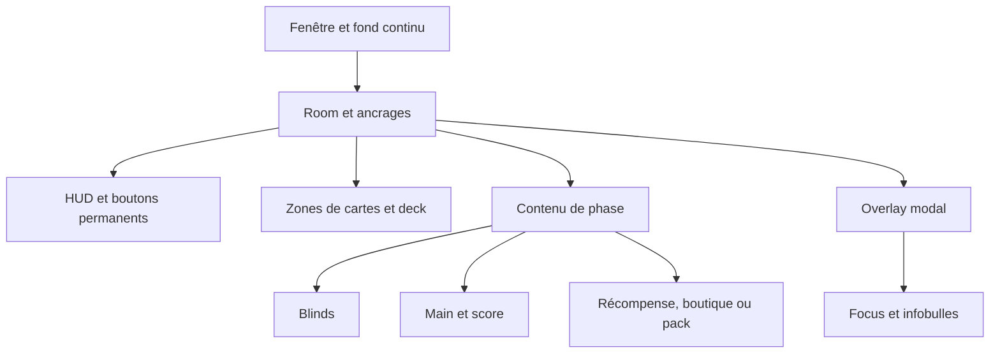
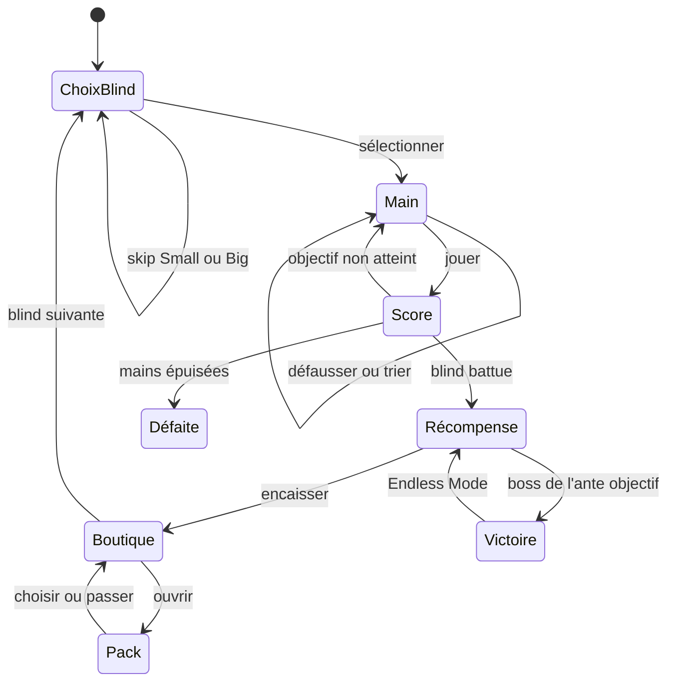

# Balatro 1.0.1o — bibliothèque des interfaces

Référence fonctionnelle relevée dans l'installation Windows locale. Les chemins Lua ci-dessous sont relatifs à la racine du jeu. Les noms de fonctions permettent de retrouver les définitions. Les descriptions sont rédigées pour Ante. Pour savoir quoi convertir et comment le vérifier, voir [le guide Bevy](UI_BEVY_GUIDE.md).

## Index

- [Couches et mise à l'échelle](#couches-et-mise-à-léchelle)
- [Menu, profils, réglages et collection](#menu-profils-réglages-et-collection)
- [Démarrage, pause et informations](#démarrage-pause-et-informations)
- [Boucle du plateau](#boucle-du-plateau)
- [Inventaires, deck et infobulles](#inventaires-deck-et-infobulles)
- [Victoire, défaite et Endless](#victoire-défaite-et-endless)
- [Entrées et raccourcis](#entrées-et-raccourcis)
- [Conditions des contrôles](#conditions-des-contrôles)
- [Index des ressources locales](#index-des-ressources-locales)

## Couches et mise à l'échelle

`main.lua::love.resize` recalcule l'échelle de la room et son origine à partir du rapport de fenêtre. La fenêtre contient la salle de 20 × 11,5 unités plus `ROOM_PADDING_W` = 1 et `ROOM_PADDING_H` = 0,7 de chaque côté, soit un canevas de 22 × 12,9 unités : à 1920 × 1056, une unité vaut environ 81,9 px. Le fond remplit le viewport. Les éléments de la room conservent leurs proportions. `engine/ui.lua` compose les UIBox à partir de lignes, colonnes, textes et objets. Les objets `CardArea` et sprites s'y ancrent. `game.lua` fait évoluer l'état de la partie et monte ou retire le contenu de phase. Les définitions sont dans `functions/UI_definitions.lua`, les actions de boutons dans `functions/button_callbacks.lua`, et les effets différés dans `functions/state_events.lua` et `engine/event.lua`.

## Menu, profils, réglages et collection

| Surface et repère Lua | Composition et données | Entrées, conditions et sortie |
| --- | --- | --- |
| Menu principal · `Game:main_menu`, `create_UIBox_main_menu_buttons` | Logo et as au centre, bande de boutons et profil actif | Play ouvre Run Setup, Options ouvre le menu de réglages, Collection ouvre son index. Quit quitte l'application si le bouton est disponible sur la plateforme. |
| Profils · `profile_select`, `profile_option`, `engine/profile.lua` | Emplacements, nom, progression et statistiques du profil | Choix du profil et modification du nom. Les commandes destructives passent par une confirmation. Retour au menu d'origine. |
| Collection · `create_UIBox_your_collection*` | Index, compteurs découverts et grilles paginées pour jokers, tarots, planètes, spectraux, vouchers, boosters, decks, éditions, améliorations, sceaux, tags et blinds | Les pages changent sans toucher à la run. Les cases masquées n'exposent pas les informations d'une entrée inconnue. Retour à l'index puis à l'écran appelant. |
| Réglages · `create_UIBox_options`, `create_UIBox_settings`, `settings_tab` | Onglets Game, Video, Graphics et Audio. Sélecteurs, bascules et curseurs, valeurs issues des réglages | Certaines options dépendent de la plateforme. Le retour ferme l'onglet ou l'overlay. Les paramètres de la run restent intacts. |
| Statistiques et personnalisation · `create_UIBox_high_scores`, `create_UIBox_customize_deck` | Progression, records et sélecteur d'art par couleur | Consultation des records et changement de visuels. Depuis la pause, le retour revient à la pause. |
| Challenges · `challenges`, `challenge_list`, `challenge_description` | Liste verrouillée selon la progression. Fiche de challenge avec deck, règles et restrictions | Choisir un challenge disponible ouvre son démarrage. Annuler revient à la liste. Les écrans de fin disposent de leur propre route vers un nouveau challenge. |

## Démarrage, pause et informations

| Surface et repère Lua | Composition et données | Entrées, conditions et sortie |
| --- | --- | --- |
| New Run · `run_setup`, `run_setup_option`, `stake_option` | Modal sur le menu ou la run. Onglets, carrousel de decks, effet du deck, stake et case de graine | Les options dépendent du profil et de la disponibilité d'une sauvegarde. Seeded Run révèle le champ et la commande Paste. Play valide puis démarre. |
| Pause · `create_UIBox_options`, `overlay_menu`, `exit_overlay_menu` | Voile, réglages, nouvelle run, menu, stats, collection et personnalisation | Échap ouvre la pause. Les overlays suspendent la partie. Échap ou Back ferment la couche quand le retour est autorisé. |
| Run Info · `run_info`, `current_blinds`, `create_UIBox_current_hand_row` | Résumé des mains et niveaux, blinds, informations liées à la run | Consultation au-dessus du plateau, avec retour à la phase d'origine. |

## Boucle du plateau

| Phase et repère Lua | Composition et données | Entrées, conditions et sortie |
| --- | --- | --- |
| Choix de blind · `update_blind_select`, `create_UIBox_blind_select`, `create_UIBox_blind_choice` | HUD à gauche, trois panneaux Small, Big et Boss au centre, inventaires en haut. Chaque panneau présente objectif, jeton, récompense et règle éventuelle | Select sur la prochaine blind. Skip seulement sur Small ou Big éligible, avec aperçu du tag. Le boss n'est pas passable. |
| Main · `update_selecting_hand`, `CardArea:add_to_highlighted`, `CardArea:sort` | Main et nombre de cartes au centre bas. Play Hand et Discard entourent les commandes de tri Rank et Suit | Le clic sélectionne ou retire une carte. Le glisser-déposer change l'ordre lorsque la zone le permet. Les boutons dépendent des cartes sélectionnées et des compteurs. |
| Score · `create_UIBox_HUD_blind`, `create_UIBox_HUD`, `state_events.lua` | Score cumulé, Chips × Mult, résultat de la combinaison et mise en évidence des effets | La résolution applique les effets dans leur ordre, puis revient à la main, passe à la récompense ou termine la run. Les compteurs et la blind restent dans le HUD. |
| Récompense · `update_round_eval` | Panneau d'encaissement et détail des gains. Les zones de possession restent visibles | Cash Out crédite les gains et ouvre la boutique. Le résultat de la blind est calculé avant l'encaissement. |
| Boutique · `update_shop`, `shop`, `use_and_sell_buttons` | Offres de cartes, voucher, packs, coût de relance et prochaine blind | Acheter selon argent et capacité, utiliser ou vendre selon l'objet, relancer selon le coût, quitter vers la prochaine blind. |
| Packs · `create_UIBox_*_pack` | Offre de cartes, compteur de choix et, selon le pack, main cible | Sélection puis usage ou acquisition selon le type. Skip termine le choix. La boutique réapparaît ensuite. |

## Inventaires, deck et infobulles

- **Jokers et consommables.** Les zones sont des surfaces translucides avec un compteur d'occupation. `CardArea:init`, `emplace`, `change_size`, `align_cards` et `draw` fixent capacité, disposition et alignement. Le compteur suit les règles de capacité, y compris les effets qui la modifient. Les commandes de carte dépendent du contexte et de la sélection.
- **Deck.** `CardArea:click` appelle `deck_info` pour le deck. Le survol pendant la main peut afficher un aperçu compact distinct. Le modal **Full Deck** présente le deck, son effet, les totaux et des rangées par couleur. **Remaining** est proposé pendant la main, le jeu de la main ou la pioche, et est alors l'onglet initial. `view_deck` établit les comptes de rang et de couleur, avec une distinction entre caractéristiques de base et effectives selon les modifications. Les cartes sont triées pour la consultation. Le retour ferme l'inspection.
- **Tags.** `add_tag` et `Tag:generate_UI` ajoutent l'icône au HUD. Le premier tag se place en bas à droite et chaque nouveau tag s'ancre au-dessus du précédent. Les événements de `Tag:apply_to_run` peuvent consommer un tag selon son type et le moment.
- **Infobulles.** `Card:generate_UIBox_ability_table`, `create_UIBox_blind_popup` et `Tag:generate_UI` alimentent les détails par type et état. Le focus, le survol et la découverte déterminent leur présence. Les fenêtres d'aide n'interrompent pas les clics adressés à la carte.

## Victoire, défaite et Endless

`state_events.lua::win_game` enregistre l'événement de victoire et ouvre `create_UIBox_win` après la résolution. Le modal rassemble les statistiques disponibles, la graine et les actions de sortie. Main Menu quitte la run, New Run ouvre le sélecteur, Endless ferme l'écran de victoire pour continuer la partie courante. Certains déblocages du jeu original dépendent du mode seeded/challenge. `create_UIBox_game_over` affiche le bilan lorsque les mains sont épuisées. Le profil et le bilan de la run ont des rôles distincts. La courbe d'objectif de `misc_functions.lua::get_blind_amount` dépend du stake et augmente fortement au-delà de l'ante 8.

## Entrées et raccourcis

`main.lua::love.keypressed`, `engine/controller.lua::key_press_update`, `key_hold_update`, `key_release_update`, les `focus_args` et `globals.lua::keybind_mapping` séparent les commandes de production, les commandes de développement et les indications manette. Une touche de debug figurant dans la source ne constitue pas un raccourci de la version distribuée.

| Entrée | Contexte et résultat de référence | Conversion Ante |
| --- | --- | --- |
| Clic principal | Bouton actif, sélection d'une carte, ouverture du deck, choix de boutique ou de modal | Actions UI typées, puis validation moteur pour le jeu. |
| Survol | Mise en évidence d'une cible et infobulle de carte, blind ou tag. Aperçu compact de pioche dans certains états | Teinte du bouton, infobulles de carte et tag. Aperçu compact à traiter séparément. |
| Glisser-déposer | Déplacement dans les CardArea qui autorisent le réordonnancement | Tri Rank/Suit et sélection existent. Réordonnancement manuel à traiter séparément. |
| Échap | Quitte le focus texte en premier. Sinon ouvre Options ou ferme le modal si le retour est permis | Même priorité pour le champ seed, le deck et la pause. Le résultat de victoire exige une action. |
| Caractères, effacement, Shift et Caps Lock | Saisie lorsqu'un champ capture le clavier. Les touches du pavé numérique sont normalisées dans le contrôleur | Graine alphanumérique ou numérique, Backspace, Entrée, coller depuis Paste ou Ctrl+V. |
| R maintenu plus de 0,7 s | Pendant une run non suspendue et hors verrouillage d'entrées. Démarre une nouvelle partie, conserve la seed pour une run seeded | Restart Same Seed est exposé dans la pause. R maintenu reste un écart. |
| Navigation manette | Direction/axe choisit le focus. Les pips des boutons, les déclencheurs et le contexte indiquent l'action disponible | Contrôles souris et clavier d'Ante pour ce jalon. |
| Tab, touches de debug et mapping clavier → manette | Chemins conditionnés par le mode de développement ou les drapeaux de debug | F2 à F5 appartiennent au profiler d'Ante et ne prétendent pas reproduire ces commandes. |

Les configurations touch, les affichages dépendant de la plateforme et les menus de debug sont des variantes. Relever leurs conditions séparément lorsqu'une conversion les concerne.

### Carte de navigation

### Contrôles dépendant de la manette ou du mode debug

| Contexte | Entrées relevées | Repère et condition |
| --- | --- | --- |
| Main | X joue la main et Y défausse | Pips de Play Hand et Discard dans `UI_definitions.lua`. Le contrôle doit être actif. |
| Boutique | X relance et Y passe à la prochaine blind | Pips des boutons de la boutique. Argent et état contrôlent la relance. |
| Carte de boutique ou d'inventaire | Épaules gauche et droite selon acheter, acheter et utiliser, vendre ou utiliser | `card_focus_button` place les pips selon le type de commande. |
| Packs | Y passe le pack | Pips communs aux cinq surfaces de pack. |
| Modaux et sélection | B revient. Les épaules parcourent les onglets et certains sélecteurs | `create_UIBox_generic_options`, `create_tabs` et `create_option_cycle`. Les options peuvent masquer les pips. |
| Fin victorieuse | X active Endless | `create_UIBox_win` expose le pip lorsque cette action existe. |
| Aperçu de pioche | Gâchette gauche maintenue pendant la main | `Game:update_selecting_hand` utilise la gâchette ou le survol souris. Le relâchement retire l'aperçu compact. |
| Mapping de développement | WASD pour la croix, X/C pour X/Y, Espace et Shift pour A/B, Q/E pour les gâchettes | `keybind_mapping` sous `love.keypressed` et `love.keyreleased`. Chemin conditionné au mode non distribué et au mapping actif. |
| Outils de développement | Tab ouvre ou retire la boîte de debug. H, 8 et 9 basculent UI, curseur et infobulles. V pilote le profiler legacy et P bascule son mode de mesure | `Controller:key_press_update` et `key_release_update`. Dépend des drapeaux de debug et du verrouillage d'entrées. Les actions de test qui démarrent ou modifient une run restent documentées dans le code local. |

Les glyphes A/B et X/Y peuvent être échangés par les drapeaux de plateforme dans `globals.lua`. Ces pips sont des références de comportement et n'indiquent pas un mapping manette implémenté dans Ante.

## Conditions des contrôles

Dans `functions/button_callbacks.lua`, les fonctions `G.FUNCS.can_*` réévaluent les contrôles à partir de la partie. Un contrôle grisé peut conserver son cadre et son libellé. Le callback d'action retire ou réactive la commande selon la condition.

| Contrôle | Source | Conditions et suite |
| --- | --- | --- |
| Play dans Run Setup | `can_start_run`, `start_setup_run` | Le deck consulté doit être débloqué. Le démarrage utilise le deck et le stake choisis ainsi que l'état du mode seeded. |
| Play Hand | `can_play` | Entre une et cinq cartes surlignées, hors blocage de la blind. Le jeu de la main ouvre la résolution, qui décide de la phase suivante. |
| Discard | `can_discard` | Au moins une carte surlignée et une défausse disponible. Les cartes sont remplacées avant de rendre le contrôle. |
| Buy / Buy & Use | `can_buy`, `can_buy_and_use`, `buy_from_shop` | Le coût tient compte du seuil d'endettement. L'achat vérifie aussi la place. Acheter et utiliser demande une cible ou un contexte éligible et résout la carte directement. |
| Reroll | `can_reroll`, `reroll_shop` | Fonds disponibles ou coût nul. Actualise les offres concernées sans quitter la boutique. |
| Sell / Use | `can_sell_card`, `can_use_consumeable`, `use_card` | La carte et le contexte de la partie décident. Un consommable ciblé peut dépendre de la sélection de la main. |
| Redeem / Open | `can_redeem`, `can_open`, `use_card` | Le voucher doit être abordable. L'ouverture d'un pack abordable présente sa sélection et son nombre de choix. |
| Select / Skip dans un pack | `can_select_card`, `can_skip_booster` | Le joker choisi doit tenir dans sa zone, avec l'exception de la capacité liée à son édition. Skip dépend du contenu du pack et de son état d'ouverture. |

## Index des ressources locales

Le registre de `game.lua` donne les tailles de cases et utilise la variante de résolution active sous `resources/textures/`. Les éléments géométriques des boutons et des panneaux viennent des définitions UI. L'index distingue les atlas qui habillent ces éléments des données qui produisent leur contenu.

| Surfaces | Ressources de référence |
| --- | --- |
| Menu, profils, réglages, navigation et écrans de fin | `balatro.png` pour le logo, `ui_assets.png` et `icons.png` pour les repères, `gamepad_ui.png` pour les indications de manette, `resources/fonts/` pour la police selon la langue. Les panneaux et les statistiques proviennent des UIBox. |
| Démarrage, challenge, aperçu du deck et difficulté | Dos dans `Enhancers.png`, jetons dans `chips.png`, progression dans `stickers.png`. Le deck et les conditions de challenge proviennent du profil et de la configuration. |
| Blinds, HUD, score et tags | `BlindChips.png` et `tags.png` pour les icônes. Les textes, valeurs et panneaux de score sont composés. Les shaders de score et de fond constituent une couche distincte. |
| Main, pioche, inspection, inventaires et collection | `8BitDeck.png` pour les faces, `Enhancers.png` pour les surfaces, `Jokers.png` et `Tarots.png` pour les cartes spéciales. Les variantes d'art et les éditions dépendent des réglages et des données de la carte. |
| Boutique, récompense et packs | `ShopSignAnimation.png` pour l'enseigne, `Vouchers.png` et `boosters.png` pour les offres correspondantes. Les offres de cartes utilisent les atlas d'inventaire et l'encaissement compose ses lignes à partir de la manche. |
| Infobulles et Run Info | Les données de la carte, de la blind ou de la main déterminent les textes et couleurs. Réutiliser l'icône de l'entité lorsqu'elle fait partie du panneau. |

## Aperçu de la main et calendrier des effets

`CardArea:parse_highlighted` relit la combinaison lorsqu’une carte change de sélection. Il présente les valeurs du niveau courant avant toute contribution des cartes et jokers. Pendant le score, la résolution remplace cet aperçu par les valeurs calculées. Run Info consulte les niveaux, le nombre de mains jouées, les blinds et les vouchers.

| Moment | Tags concernés |
| --- | --- |
| Acquisition | Handy, Garbage, Speed, Economy, Orbital et Top-up. Double copie le prochain tag admissible avec ses paramètres. |
| Choix de blind | Boss change la prochaine blind Boss. Standard, Charm, Meteor, Ethereal et Buffoon ouvrent un pack gratuit. |
| Début ou évaluation de manche | Juggle augmente temporairement la taille de main. Investment augmente la récompense du prochain boss battu. |
| Boutique | Uncommon et Rare proposent un joker gratuit. Foil, Holographic, Polychrome et Negative transforment une offre éligible. Voucher ajoute une offre, D6 rend la prochaine relance gratuite et Coupon rend gratuits les cartes et packs proposés à l’ouverture. |

Pour les vouchers, `Card:apply_to_run` et les points de lecture des réglages de run distinguent le gain immédiat des avantages persistants. Vérifier dans cet ordre les extensions de boutique, remises, rareté des éditions, relances, achats de cartes à jouer, génération et effets des packs, capacités, mains et défausses, intérêts, réduction d’ante et relance du boss. Blank est le prérequis d’Antimatter. La condition de carrière est distincte du prérequis à posséder dans la run.

## Boutique et aperçu de pioche

`G.UIDEF.shop` compose trois zones d'offres et place la navigation à gauche. `create_shop_card_ui` attache un prix et une commande contextuelle à chaque objet. L'enseigne utilise une séquence dédiée. La capture de référence montre des prix au-dessus des objets, sans nom sous l'illustration.

Dimensions relevées dans le source, en unités :

| Élément | Valeur |
| --- | --- |
| Panneau | haut à 3,92 dans la salle, centré sur la zone de main, cadre de la couleur de phase (rouge) avec padding 0,1 |
| Next Round | 2,8 × 1,5, rouge, deux lignes |
| Reroll | 2,8 × 1,6, vert, « Reroll » puis le prix en grand |
| Boîte Jokers | `L_BLACK`, padding 0,2, largeur min 8,2 ; zone `joker_max` × 1,02 × `CARD_W` sur 1,05 × `CARD_H` |
| Boîte vouchers | `L_BLACK` padding 0,15, boîte noire padding 0,2, libellé vertical, zone 2,1 × `CARD_W` |
| Boîte boosters | `L_BLACK`, zone 2,4 × `CARD_W` sur 1,15 × `CARD_H`, cartes à 1,27 fois la taille |
| Étiquette de prix | boîte `darken(BLACK, 0,2)` min 0,6 × 1, boîte intérieure `lighten(BLACK, 0,1)` min 1 × 0,55, prix en `MONEY` à l'échelle 0,5, descendue de 0,38 derrière le haut de la carte |
| Buy | orange (`G.C.ORANGE`), sous la carte (`bm`, −0,3), min 1,1 × 0,94 ; inactif en gris |
| Buy & Use | rouge, à droite (`cr`, −0,3), min 1,1 × 1,1, « BUY » puis « & USE » plus petit ; masqué s'il est impossible |
| Redeem, Open | verts, même placement que Buy |
| Enseigne | boîte min 4,72 × 3,1, enseigne 4,4 × 2,2, ligne dorée dessous |

`G.UIDEF.use_and_sell_buttons` : Sell est vert (`G.C.GREEN`) quand la vente est possible, sinon inactif ; il est ancré `cr` avec un décalage de −0,4, donc en partie sous la carte ; largeur min 1,25, padding 0,1, coins 0,08 ; « SELL » à l'échelle 0,4 puis « $ » (0,4) et le montant (0,55). Un consommable ajoute Use, rouge, min 1,25 × 1, sous Sell. Les boutons n'apparaissent que sur la carte sélectionnée, dessinés derrière elle.

Dessin des boîtes (`UIElement:draw_pixellated_rect`) : chaque boîte arrondie est un polygone à coins en escalier, avec des marches de 4, 2 et 1 pas depuis chaque bord. Le pas vaut `res` × 1/20 d'unité ; `res` vaut 0,8 si le petit côté dépasse 3,5 unités, 0,6 au-delà de 0,3, sinon 0,15. `emboss` ajoute dessous une lèvre de la même forme assombrie de 0,3 (0,5 au survol). `shadow` dessine une ombre noire à 30 % décalée par la parallaxe (environ 2,25 pas vers le bas). Le texte est rendu avec un em d'une unité à l'échelle 1 (`render_scale` × `FONTSCALE`). Les textes marqués `shadow` ont la même ombre noire à 30 %.

Couleurs dynamiques (`ease_background_colour_blind`, `Blind:change_colour`, `get_blind_main_colour`) :
- en boutique, `DYN_UI.MAIN` = mix(RED, BLACK, 0,9) ;
- pour un blind, MAIN est la couleur du blind (Small : mix(BLUE, BLACK, 0,6), Big : mix(ORANGE, BLACK, 0,6), boss : `boss_colour`) et DARK = mix(MAIN, BLACK, 0,4) ;
- hors boss, `BOSS_MAIN` = darken(BLACK, 0,05) et `BOSS_DARK` = lighten(BLACK, 0,07) ; pour un boss, `BOSS_MAIN` = sa couleur et `BOSS_DARK` = mix(couleur, BLACK, 0,2).

Le fond est le shader `background`, nourri par `G.C.BACKGROUND` (C, L, D et contraste) :
- Small et Big Blind : #50846e × 0,9, 1,3 et 0,7, contraste 1 ;
- boss : C = sa couleur, L = 1,3 × lighten(mix(couleur, BLACK, 0,3), 0,1), contraste 2 ;
- boss final : BLUE, RED et darken(BLACK, 0,4), contraste 3 ;
- `spin_time` reste à 0 en partie.

HUD (`create_UIBox_HUD`) :
- cadre : `TRANSPARENT_DARK` (0,03), puis `DYN_UI.MAIN` (0,05), puis le corps `BOSS_DARK` (0,08) ;
- chaque compteur est une boîte `BOSS_MAIN` avec relief de 0,05 : titre à 0,34, nombre à 0,8 (argent 0,88) dans une boîte `BOSS_DARK` de largeur min 1,2 ;
- Ante s'affiche « n » en `IMPORTANT`, suivi de « / 8 » plus petit ;
- Round score : deux lignes à 0,42, puis une boîte de 3,3 × 0,7 avec le jeton de mise (0,5) et le score à 0,85 ;
- nom de main à 0,56 ; Chips et Mult côte à côte (2 × 1) à 0,92, séparés d'un « X ».

La boutique est ancrée `'tmi'` sur la main avec un décalage de −5,3 : son haut est à 3,587 unités. Son corps `BOSS_DARK` a une hauteur minimum de 30 unités et descend sous la fenêtre.

L'enseigne `shop_sign` a 4 images de 113 × 57 jouées à `ANIMATION_FPS` = 10. Elle est placée dans `DYN_UI.MAIN` (relief 0,05), puis `DYN_UI.DARK` (minimum 4,72 × 3,1), avec `ph_improve_run` dessous en lighten(GOLD, 0,3) à 0,5, qui flotte.

Le deck (`align_cards`, type `deck`) décale chaque carte de `shadow_parrallax` × 0,15/52 par carte au-dessous d'elle. La parallaxe x vaut (centre − 10)/10 × 1,5 ≈ 1,26 et y vaut −1,5. Seuls la première carte, une carte sur neuf et la dernière sont dessinées.

`can_use_consumeable` exige de la place pour les cartes créées : L'Empereur et La Grande Prêtresse demandent un emplacement libre, sauf depuis l'inventaire où la carte libère d'abord le sien (`use_consumeable` crée alors min(2, places libres) cartes). Depuis un pack, avec les emplacements pleins, elles ne sont pas sélectionnables. Buy & Use (`can_buy_and_use`) suit la même règle sans occuper d'emplacement.

`generate_card_ui` et `G.UIDEF.card_h_popup` séparent titre, effet, badges et encarts de contexte. `Game:update_selecting_hand` montre la grille de pioche au survol du deck et masque alors les boutons de main. `G.UIDEF.deck_preview` agrège par rang et couleur et distingue Stone et les modifications effectives. L'inspection au clic reste un parcours séparé.

## Rythme du score et vitesse

Les événements de `engine/event.lua` attendent sur l'horloge `G.TIMERS.TOTAL`, qui avance de `dt × SPEEDFACTOR`. En run, `SPEEDFACTOR` vaut `G.SETTINGS.GAMESPEED` (0,5, 1, 2 ou 4 dans l'original ; 1 par défaut), plus `max(0, ACC − 2)`. Dans les états `HAND_PLAYED` et `NEW_ROUND`, `ACC` croît de 0,2 × `GAMESPEED` par seconde réelle, plafonné à 16. Le juice tourne sur le temps réel et n'est pas accéléré. `GAMESPEED` est un réglage enregistré.

| Étape (`state_events.lua`, `common_events.lua`) | Durée en secondes de jeu |
| --- | --- |
| Main dépensée, puis pause | 0,4 |
| Chaque carte va de la main à la zone de jeu (`draw_card`) | 0,1 par carte |
| Début de l'évaluation | 0,2 |
| Montée de chaque carte qui score (`highlight_card`) | 0,1 par carte |
| Nouveau nom de main (rare : déjà affiché à la sélection) | 0,3 + 0,4 |
| Avant le premier popup, main non débuffée | 0,4 |
| Popup chips (`card_eval_status_text`, délai × 1,25) | 0,75 |
| Popup mult, xmult, argent | 0,8125 |
| Popup de Joker ou « Again! » | 0,9375 |
| Descente des cartes, total affiché, comptage, ease du score, pause | 0,1 par carte + 0,4 + 0,8 + 0,5 + 0,3 |
| Chaque carte va de la zone de jeu à la défausse | 0,1 par carte |

Le popup apparaît au début de son délai. `card_eval_status_text` l'aligne en haut (`tm`, décalé de −0,05 × `CARD_H`) pour les cartes jouées ou tenues, et en bas (`bm`, décalé de 0,05 × hauteur) pour les Jokers et consommables. La source fait `juice_up(0.6, 0.1)`. Couleurs : chips en `G.C.CHIPS`, mult et xmult en `G.C.MULT` / `G.C.XMULT`, argent en `G.C.MONEY`, édition en `G.C.DARK_EDITION`.

## Mult décimal et score

Le Mult de l'original est un nombre décimal : `mod_mult` renvoie la valeur sans arrondi, les XMult multiplient directement et le score de la main est `math.floor(hand_chips * mult)`. The Flint (`Blind:modify_hand`) divise les chips et le Mult de base par deux en arrondissant au plus proche (`math.floor(x * 0.5 + 0.5)`), avec un Mult d'au moins 1. `number_format` écrit un nombre entier sans décimale et sinon avec 2 décimales sous 10, 1 sous 100 et aucune au-delà, avec des virgules de milliers et une notation scientifique à partir de 10¹¹.

## Géométrie des zones de cartes

Une unité de salle vaut 20 × 3,65 = 73 px à l'échelle de base ; la salle mesure 20 × 11,5 unités. `CARD_W` ≈ 2,049, `CARD_H` ≈ 2,751 et `HIGHLIGHT_H` = 0,2 × `CARD_H`. Les positions viennent de `set_screen_positions` (`functions/common_events.lua`).

| Zone | Largeur | Position |
| --- | --- | --- |
| Main | 6 × `CARD_W` | x ≈ 4,86, y ≈ 8,89 |
| Jeu | 5,3 × `CARD_W` | centrée sur la main, y = main − 3,6 |
| Jokers | 4,9 × `CARD_W` | x = main − 0,1, y = 0 |
| Consommables | 2,3 × `CARD_W` | à droite des Jokers + 0,2, y = 0 |
| Deck | 1,1 × `CARD_W` | x ≈ 17,25, y ≈ 8,89 |

`CardArea:align_cards` répartit les Jokers, consommables et offres : x = (w − card_w) × (k/(m−1) + 0,5 × (m−n)/(m−1)), avec m = max(n, limite). Le HUD de `create_UIBox_HUD` commence 0,7 unité à gauche de la salle sur toute la hauteur du canevas, pour environ 5,1 unités de large : Round score 3,3 × 0,7, nom de main 1,1 de haut, Chips et Mult 2 × 1, Run Info et Options 1,5 × 1,75, Hands et Discards 1,45 × 1,15, argent 3,3 × 0,7, Ante et Round 1,45 × 1.

Une carte sélectionnée en main, une carte qui score et un consommable sélectionné montent de `HIGHLIGHT_H` ; un Joker sélectionné de la moitié. La main s'ouvre en éventail : rotation 0,2 × (k − n/2 − 0,5) / n, avec une légère oscillation ; n est le nombre de cartes présentes dans la main. Une carte du deck est face cachée ; `CardArea:emplace` la retourne en entrant dans la main (`Card:flip`) : `Moveable:move_wh` pince sa largeur de 8 largeurs par seconde réelle jusqu'à zéro, change la face, puis la rouvre au même rythme. Les cartes envoyées à la défausse ne sont pas retournées.

## Survol, juice et inclinaison

`Card.T.scale` vaut 0,95. `Moveable:move_scale` vise +0,05 au survol et +0,1 au drag, approché par `exp(-60·dt)` ; la position suit `exp(-50·dt)` et la rotation `exp(-190·dt)`. Le survol ne déplace pas la carte : il fait `juice_up(0.05, 0.03)` et joue `paper1`. Un juice dure 0,4 s réel : l'échelle oscille en `amount × sin(50,8 t) × (1 − p)³`, la rotation en `r × sin(40,8 t) × (1 − p)²`, avec `amount` = 0,4 × arg et `r` = ±0,4 × arg. L'inclinaison suit le curseur avec un facteur 0,3 et une inclinaison ambiante de 0,2.

## Infobulles : composition et ancrage

`G.UIDEF.card_h_popup` compose un cadre gris clair (`JOKER_GREY` éclairci), une boîte intérieure sombre, le nom en blanc, une boîte blanche de description et une ligne de badges. Le badge de rareté utilise Common `009dff`, Uncommon `4BC292`, Rare `fe5f55` et Legendary `b26cbb`. Les textes de localisation utilisent des blocs `{C:…}` (couleur), `{X:…}` (pastille) et `#n#` (variable). La ligne « Currently » est entièrement en `inactive` (`88888899`) sauf la valeur.

`Card:align_h_popup` place l'infobulle au-dessus de la carte, en dessous si le haut de la carte est à moins de 0,8 × `CARD_H` du haut, et à gauche pour la boutique, les boutons d'achat et la vue Deck. Les infobulles latérales (`info_queue`) s'empilent à gauche du popup principal et sont centrées sur lui (`show_infotip`, `align = 'cl'`, décalage −0,03). `generate_card_ui` met d'abord les références de l'effet (améliorations des Tarots et de certains Jokers, éditions de Wheel of Fortune, Aura, Hex et des tags, sceaux de Talisman, Deja Vu, Trance et Medium), puis celles des badges : édition, sceau, Eternal, Perishable, Rental, épinglé. Chaque encart (`info_tip_from_rows`) a un cadre gris clair, un bandeau gris (`G.C.GREY` éclairci de 0,15) avec le titre en texte clair à l'échelle 0,32, et une boîte blanche d'au moins 1,5 unité de large.

## Outils de debug d'origine

`_RELEASE_MODE` est vrai dans la version distribuée, ce qui désactive tout le debug. Hors release, Tab ouvre `create_UIBox_debug_tools` : +10 $, +manche, +ante, +main, +défausse, relancer le boss, +10 chips, +10 mult, ×2 chips, ×10 mult, remise à zéro, gagner, perdre, et des options de Jimbo et du fond. D'autres touches : 1, 2 et 3 sur une carte de collection (débloquer, découvrir, ajouter), Q (changer d'édition), H (UI), 8 (curseur) et 9 (infobulles). L'argent de départ normal est 4 $ (`get_starting_params`).

## Shaders

Les 19 fichiers de `resources/shaders` sont du GLSL LÖVE : uniforms `extern`, type `number`, `Image` et `Texel`, point d'entrée `effect(colour, texture, texture_coords, screen_coords)` et partie vertex `position()` sous `#ifdef VERTEX`. `skew` et `vortex` n'ont que la partie vertex. `Card:draw` dessine le sprite de base avec `dissolve`, puis l'édition en surcouche sur le centre et sur la face : `foil`, `holo`, `polychrome`, ou `negative` à la place de la base suivi de `negative_shine`. `voucher` et `booster` s'appliquent aux vouchers, tickets et boosters ; les sceaux d'or et les stickers utilisent aussi `voucher`. `Sprite:draw_shader` envoie :

| Uniform | Valeur |
| --- | --- |
| paramètre nommé comme le shader | (min(3 × rotation, 1) + temps réel / 28 + juice × 20 + inclinaison, temps réel) |
| `time` | 123,33412 × (ID / 1,14212) mod 3000, constant par carte |
| `dissolve` | 0, sauf vente ou destruction |
| `texture_details` | cellule de l'atlas (x, y) et taille de cellule en pixels |
| `image_details` | taille de l'atlas en pixels |
| `burn_colour_1`, `burn_colour_2` | transparent, sauf dissolve |
| `shadow` | vrai pour l'ombre portée |
| `hovering`, `mouse_screen_pos`, `screen_scale` | inclinaison de la partie vertex |

## Sons, salle et dissolution

`play_sound(nom, per, vol)` joue un effet à la hauteur `per` et au volume `vol × SOUND.volume/100 × SOUND.game_sounds_volume/100` (50 et 100 par défaut). `Card:hover` joue `paper1` (0,9 à 1,1 ; 0,35), un clic d'interface `button` (1 ; 0,3), la sélection d'une carte `cardSlide1` et sa désélection `cardSlide2` (0,3), `draw_card` joue `card1` (0,95 ; 0,6), achats et ventes `coin2`, et `card_eval_status_text` `chips1`, `multhit1`, `multhit2` (0,7), `coin3` ou `generic1` selon le popup.

`update_canvas_juice` déplace la salle : `G.ROOM.jiggle` reçoit +0,7 par popup, diminue de `(1 − 5·dt)` par image et ajoute une oscillation rapide ; une dérive lente et un léger attrait vers le curseur s'y ajoutent, multipliés par `screenshake/100 × 3` (1,5 par défaut).

`Card:start_dissolve(couleurs)` dure 0,7 s : `dissolve` passe de 0 à 1, les deux premières couleurs servent de bords de brûlure (or à la vente, sinon noir et orange), des particules de ces couleurs s'échappent, et `whoosh2` et un `crumple` sont joués. La carte est retirée à 1,05 × la durée.
