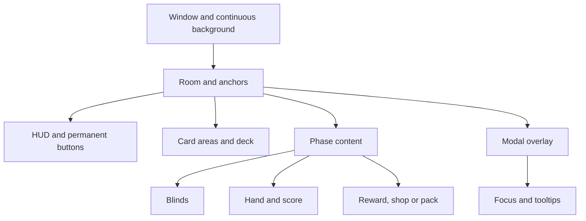
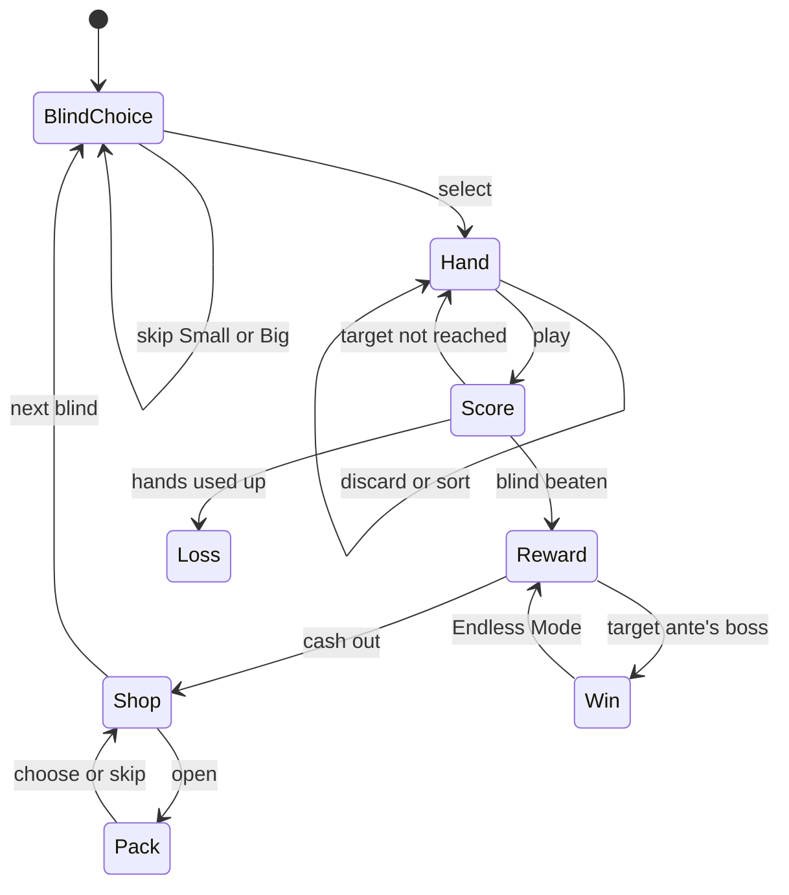
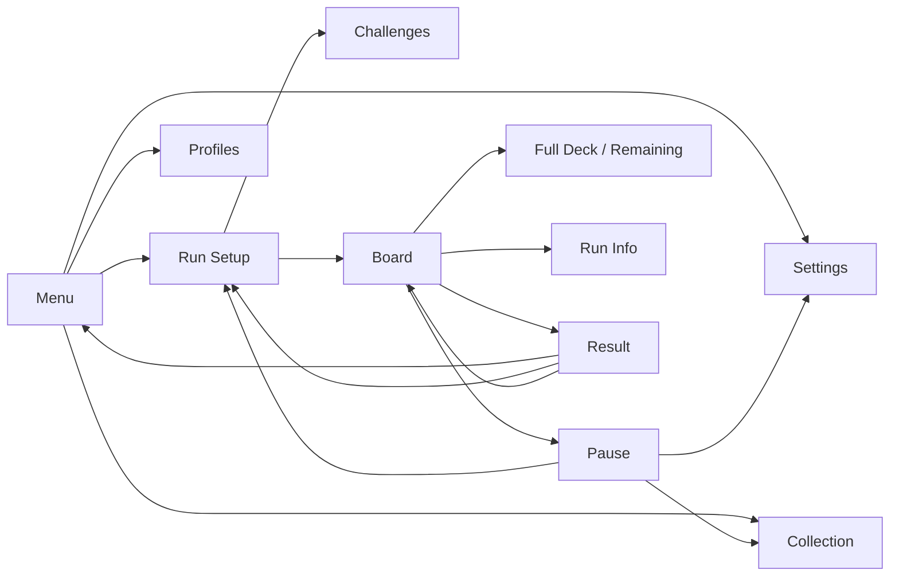

# Balatro 1.0.1o — interface library

Functional reference recorded from the local Windows installation. The Lua paths below are relative to the game's root. The function names let you find the definitions. The descriptions are written for Ante. To know what to convert and how to check it, see [the Bevy guide](UI_BEVY_GUIDE.md).

## Index

- [Layers and scaling](#layers-and-scaling)
- [Menu, profiles, settings and collection](#menu-profiles-settings-and-collection)
- [Run setup, pause and information](#run-setup-pause-and-information)
- [Board loop](#board-loop)
- [Inventories, deck and tooltips](#inventories-deck-and-tooltips)
- [Win, loss and Endless](#win-loss-and-endless)
- [Input and shortcuts](#input-and-shortcuts)
- [Control conditions](#control-conditions)
- [Local resource index](#local-resource-index)

## Layers and scaling

`main.lua::love.resize` recomputes the room's scale and origin from the window's aspect ratio. The window holds the 20 × 11.5 unit room plus `ROOM_PADDING_W` = 1 and `ROOM_PADDING_H` = 0.7 on each side, a 22 × 12.9 unit canvas: at 1920 × 1056, one unit is about 81.9 px. The background fills the viewport. Room elements keep their proportions. `engine/ui.lua` builds UIBoxes from rows, columns, text and objects. `CardArea` objects and sprites are anchored in them. `game.lua` advances the game state and mounts or removes the phase content. The definitions are in `functions/UI_definitions.lua`, button actions in `functions/button_callbacks.lua`, and deferred effects in `functions/state_events.lua` and `engine/event.lua`.

## Menu, profiles, settings and collection

| Surface and Lua landmark | Composition and data | Input, conditions and exit |
| --- | --- | --- |
| Main menu · `Game:main_menu`, `create_UIBox_main_menu_buttons` | Logo and ace in the centre, button strip and active profile | Play opens Run Setup, Options opens the settings menu, Collection opens its index. Quit leaves the application if the button exists on the platform. |
| Profiles · `profile_select`, `profile_option`, `engine/profile.lua` | Slots, name, progress and profile statistics | Choose a profile and edit its name. Destructive commands go through a confirmation. Returns to the original menu. |
| Collection · `create_UIBox_your_collection*` | Index, discovered counters and paged grids for jokers, tarots, planets, spectrals, vouchers, boosters, decks, editions, enhancements, seals, tags and blinds | Pages change without touching the run. Hidden slots do not expose an unknown entry's information. Returns to the index, then to the calling screen. |
| Settings · `create_UIBox_options`, `create_UIBox_settings`, `settings_tab` | Game, Video, Graphics and Audio tabs. Selectors, toggles and sliders, values from the settings | Some options depend on the platform. Back closes the tab or the overlay. The run's parameters stay untouched. |
| Statistics and customisation · `create_UIBox_high_scores`, `create_UIBox_customize_deck` | Progress, records and an art selector per suit | View records and change visuals. From the pause, back returns to the pause. |
| Challenges · `challenges`, `challenge_list`, `challenge_description` | List locked by progress. Challenge sheet with deck, rules and restrictions | Choosing an available challenge opens its setup. Cancel returns to the list. End screens have their own route to a new challenge. |

## Run setup, pause and information

| Surface and Lua landmark | Composition and data | Input, conditions and exit |
| --- | --- | --- |
| New Run · `run_setup`, `run_setup_option`, `stake_option` | Modal over the menu or the run. Tabs, deck carousel, deck effect, stake and seed box | Options depend on the profile and on whether a save exists. Seeded Run reveals the field and the Paste command. Play validates, then starts. |
| Pause · `create_UIBox_options`, `overlay_menu`, `exit_overlay_menu` | Shade, settings, new run, menu, stats, collection and customisation | Escape opens the pause. Overlays pause the game. Escape or Back close the layer when going back is allowed. |
| Run Info · `run_info`, `current_blinds`, `create_UIBox_current_hand_row` | Summary of hands and levels, blinds, run information | Read-only above the board, returning to the original phase. The Blinds tab draws the blind choice panels with their state (`create_UIBox_blind_choice(type, true)`). |

## Board loop

| Phase and Lua landmark | Composition and data | Input, conditions and exit |
| --- | --- | --- |
| Blind choice · `update_blind_select`, `create_UIBox_blind_select`, `create_UIBox_blind_choice` | HUD on the left, three Small, Big and Boss panels in the centre, inventories at the top. Each panel shows the target, chip, reward and any rule | Select on the next blind. Skip only on an eligible Small or Big, with a tag preview. The boss cannot be skipped. |
| Hand · `update_selecting_hand`, `CardArea:add_to_highlighted`, `CardArea:sort` | Hand and card count at the bottom centre. Play Hand and Discard surround the Rank and Suit sort controls | A click selects or deselects a card. Drag and drop changes the order where the area allows it. The buttons depend on the selected cards and the counters. |
| Score · `create_UIBox_HUD_blind`, `create_UIBox_HUD`, `state_events.lua` | Total score, Chips × Mult, the hand's result and highlighted effects | Resolution applies the effects in order, then returns to the hand, moves to the reward or ends the run. Counters and the blind stay in the HUD. |
| Reward · `update_round_eval` | Cash out panel and earnings breakdown. The possession areas stay visible | Cash Out credits the earnings and opens the shop. The blind's result is computed before the cash out. |
| Shop · `update_shop`, `shop`, `use_and_sell_buttons` | Card offers, voucher, packs, reroll cost and next blind | Buy depending on money and capacity, use or sell depending on the object, reroll depending on the cost, leave for the next blind. |
| Packs · `create_UIBox_*_pack` | Card offer, choice counter and, depending on the pack, a target hand | Select, then use or acquire depending on the type. Skip ends the choice. The shop reappears afterwards. |

## Inventories, deck and tooltips

- **Jokers and consumables.** The areas are translucent surfaces with an occupancy counter. `CardArea:init`, `emplace`, `change_size`, `align_cards` and `draw` set capacity, layout and alignment. The counter follows the capacity rules, including the effects that change it. Card commands depend on context and selection.
- **Deck.** `CardArea:click` calls `deck_info` for the deck. Hovering during the hand can show a separate compact preview. The **Full Deck** modal shows the deck, its effect, the totals and rows per suit. **Remaining** is offered during the hand, while the hand is played or during the draw, and is then the initial tab. `view_deck` establishes rank and suit counts, telling base and effective characteristics apart according to the modifications. Cards are sorted for viewing. Back closes the inspection.
- **Tags.** `add_tag` and `Tag:generate_UI` add the icon to the HUD. The first tag sits at the bottom right and each new tag is anchored above the previous one. `Tag:apply_to_run` events can consume a tag depending on its type and the moment.
- **Tooltips.** `Card:generate_UIBox_ability_table`, `create_UIBox_blind_popup` and `Tag:generate_UI` feed the details per type and state. Focus, hover and discovery decide whether they appear. Help popups do not intercept the clicks meant for the card.

## Win, loss and Endless

`state_events.lua::win_game` records the win event and opens `create_UIBox_win` after resolution. The modal gathers the available statistics, the seed and the exit actions. Main Menu leaves the run, New Run opens the selector, Endless closes the win screen to continue the current game. Some of the original game's unlocks depend on the seeded/challenge mode. `create_UIBox_game_over` shows the summary when the hands run out. The profile and the run summary have distinct roles. The target curve of `misc_functions.lua::get_blind_amount` depends on the stake and rises steeply beyond ante 8.

## Input and shortcuts

`main.lua::love.keypressed`, `engine/controller.lua::key_press_update`, `key_hold_update`, `key_release_update`, the `focus_args` and `globals.lua::keybind_mapping` separate production commands, development commands and controller hints. A debug key present in the source is not a shortcut of the shipped version.

| Input | Reference context and result | Ante conversion |
| --- | --- | --- |
| Primary click | Active button, card selection, opening the deck, a shop or modal choice | Typed UI actions, then engine validation for gameplay. |
| Hover | Highlights a target and shows the card, blind or tag tooltip. Compact draw preview in some states | Button tint, card and tag tooltips. Compact preview handled separately. |
| Drag and drop | Moves cards in the CardAreas that allow reordering | Rank/Suit sorting and selection exist. Manual reordering handled separately. |
| Escape | Leaves text focus first. Otherwise opens Options or closes the modal if going back is allowed | Same priority for the seed field, the deck and the pause. The win result requires an action. |
| Characters, erase, Shift and Caps Lock | Typing when a field captures the keyboard. Numpad keys are normalised in the controller | Alphanumeric or numeric seed, Backspace, Enter, paste from Paste or Ctrl+V. |
| R held for more than 0.7 s | During an unpaused run outside an input lock. Starts a new game, keeping the seed for a seeded run | Restart Same Seed is exposed in the pause. Holding R remains a gap. |
| Controller navigation | Direction/axis picks the focus. Button pips, triggers and context show the available action | Ante's mouse and keyboard controls for this milestone. |
| Tab, debug keys and keyboard → controller mapping | Paths gated by development mode or debug flags | F2 to F5 belong to Ante's profiler and do not claim to reproduce these commands. |

Touch configurations, platform-dependent displays and debug menus are variants. Record their conditions separately when a conversion involves them.

### Navigation map

### Controller and debug-mode controls

| Context | Inputs recorded | Landmark and condition |
| --- | --- | --- |
| Hand | X plays the hand and Y discards | Play Hand and Discard pips in `UI_definitions.lua`. The control must be active. |
| Shop | X rerolls and Y moves to the next blind | Shop button pips. Money and state control the reroll. |
| Shop or inventory card | Left and right shoulders for buy, buy and use, sell or use | `card_focus_button` places the pips by command type. |
| Packs | Y skips the pack | Pips shared by the five pack surfaces. |
| Modals and selection | B goes back. The shoulders cycle through tabs and some selectors | `create_UIBox_generic_options`, `create_tabs` and `create_option_cycle`. Options can hide the pips. |
| Winning end | X activates Endless | `create_UIBox_win` shows the pip when that action exists. |
| Draw preview | Left trigger held during the hand | `Game:update_selecting_hand` uses the trigger or mouse hover. Releasing removes the compact preview. |
| Development mapping | WASD for the d-pad, X/C for X/Y, Space and Shift for A/B, Q/E for the triggers | `keybind_mapping` under `love.keypressed` and `love.keyreleased`. Path gated by non-shipped mode and an active mapping. |
| Development tools | Tab opens or removes the debug box. H, 8 and 9 toggle UI, cursor and tooltips. V drives the legacy profiler and P toggles its measuring mode | `Controller:key_press_update` and `key_release_update`. Depends on debug flags and the input lock. The test actions that start or change a run stay documented in the local code. |

The A/B and X/Y glyphs can be swapped by platform flags in `globals.lua`. These pips are behaviour references and do not mean a controller mapping is implemented in Ante.

## Control conditions

In `functions/button_callbacks.lua`, the `G.FUNCS.can_*` functions re-evaluate controls from the game. A greyed control can keep its frame and label. The action callback removes or re-enables the command according to the condition.

| Control | Source | Conditions and follow-up |
| --- | --- | --- |
| Play in Run Setup | `can_start_run`, `start_setup_run` | The deck viewed must be unlocked. The start uses the chosen deck and stake and the seeded mode state. |
| Play Hand | `can_play` | Between one and five highlighted cards, unless the blind blocks it. Playing the hand opens resolution, which decides the next phase. |
| Discard | `can_discard` | At least one highlighted card and a discard left. The cards are replaced before the control comes back. |
| Buy / Buy & Use | `can_buy`, `can_buy_and_use`, `buy_from_shop` | The cost accounts for the debt threshold. The purchase also checks room. Buy and use needs an eligible target or context and resolves the card directly. |
| Reroll | `can_reroll`, `reroll_shop` | Funds available or a zero cost. Refreshes the offers concerned without leaving the shop. |
| Sell / Use | `can_sell_card`, `can_use_consumeable`, `use_card` | The card and the game context decide. A targeted consumable can depend on the hand's selection. |
| Redeem / Open | `can_redeem`, `can_open`, `use_card` | The voucher must be affordable. Opening an affordable pack shows its selection and number of choices. |
| Select / Skip in a pack | `can_select_card`, `can_skip_booster` | The chosen joker must fit in its area, except for the capacity tied to its edition. Skip depends on the pack's content and opening state. |

## Local resource index

The `game.lua` registry gives the cell sizes and uses the active resolution variant under `resources/textures/`. The geometry of buttons and panels comes from the UI definitions. The index tells apart the atlases that dress these elements from the data that produce their content.

| Surfaces | Reference resources |
| --- | --- |
| Menu, profiles, settings, navigation and end screens | `balatro.png` for the logo, `ui_assets.png` and `icons.png` for landmarks, `gamepad_ui.png` for controller hints, `resources/fonts/` for the font per language. Panels and statistics come from the UIBoxes. |
| Run setup, challenge, deck preview and difficulty | Backs in `Enhancers.png`, chips in `chips.png`, progress in `stickers.png`. The deck and challenge conditions come from the profile and the configuration. |
| Blinds, HUD, score and tags | `BlindChips.png` and `tags.png` for the icons. Score texts, values and panels are composed. Score and background shaders are a separate layer. |
| Hand, draw pile, inspection, inventories and collection | `8BitDeck.png` for the faces, `Enhancers.png` for the surfaces, `Jokers.png` and `Tarots.png` for special cards. Art variants and editions depend on the settings and card data. |
| Shop, reward and packs | `ShopSignAnimation.png` for the sign, `Vouchers.png` and `boosters.png` for the matching offers. Card offers use the inventory atlases and the cash out builds its rows from the round. |
| Tooltips and Run Info | The card, blind or hand data decide the texts and colours. Reuse the entity's icon when it is part of the panel. |

## Hand preview and effect timing

`CardArea:parse_highlighted` re-reads the hand when a card's selection changes. It shows the current level's values before any contribution from cards and jokers. During scoring, resolution replaces this preview with the computed values. Run Info shows levels, the number of hands played, the blinds and the vouchers.

| Moment | Tags concerned |
| --- | --- |
| Acquisition | Handy, Garbage, Speed, Economy, Orbital and Top-up. Double copies the next eligible tag with its parameters. |
| Blind choice | Boss changes the next Boss blind. Standard, Charm, Meteor, Ethereal and Buffoon open a free pack. |
| Round start or evaluation | Juggle temporarily raises the hand size. Investment raises the reward of the next boss beaten. |
| Shop | Uncommon and Rare offer a free joker. Foil, Holographic, Polychrome and Negative transform an eligible offer. Voucher adds an offer, D6 makes the next reroll free and Coupon makes the cards and packs offered on opening free. |

For vouchers, `Card:apply_to_run` and the places that read run settings tell the immediate gain apart from persistent perks. Check, in this order, shop extensions, discounts, edition rarity, rerolls, playing card purchases, pack generation and effects, capacities, hands and discards, interest, ante reduction and boss reroll. Blank is the prerequisite of Antimatter. The career condition is separate from the prerequisite owned in the run.

## Shop and draw preview

`G.UIDEF.shop` builds three offer areas and puts navigation on the left. `create_shop_card_ui` attaches a price and a contextual command to each object. The sign uses a dedicated sequence. The reference capture shows prices above the objects, with no name under the art.

Dimensions recorded from the source, in units:

| Element | Value |
| --- | --- |
| Panel | top at 3.92 in the room, centred on the hand area, frame in the phase colour (red) with padding 0.1 |
| Next Round | 2.8 × 1.5, red, two lines |
| Reroll | 2.8 × 1.6, green, "Reroll" then the price in large type |
| Jokers box | `L_BLACK`, padding 0.2, min width 8.2; area `joker_max` × 1.02 × `CARD_W` by 1.05 × `CARD_H` |
| Vouchers box | `L_BLACK` padding 0.15, black box padding 0.2, vertical label, area 2.1 × `CARD_W` |
| Boosters box | `L_BLACK`, area 2.4 × `CARD_W` by 1.15 × `CARD_H`, cards at 1.27 times their size |
| Price tag | `darken(BLACK, 0.2)` box min 0.6 × 1, inner `lighten(BLACK, 0.1)` box min 1 × 0.55, price in `MONEY` at scale 0.5, sunk 0.38 behind the top of the card |
| Buy | orange (`G.C.ORANGE`), under the card (`bm`, −0.3), min 1.1 × 0.94; grey when inactive |
| Buy & Use | red, on the right (`cr`, −0.3), min 1.1 × 1.1, "BUY" then a smaller "& USE"; hidden when impossible |
| Redeem, Open | green, placed like Buy |
| Sign | box min 4.72 × 3.1, sign 4.4 × 2.2, golden line underneath |

`G.UIDEF.use_and_sell_buttons`: Sell is green (`G.C.GREEN`) when selling is possible, otherwise inactive; it is anchored `cr` with an offset of −0.4, so partly under the card; min width 1.25, padding 0.1, corners 0.08; "SELL" at scale 0.4 then "$" (0.4) and the amount (0.55). A consumable adds Use, red, min 1.25 × 1, under Sell. The buttons only appear on the selected card, drawn behind it.

Box drawing (`UIElement:draw_pixellated_rect`): each rounded box is a polygon with stepped corners, with steps of 4, 2 and 1 pitch from each edge. The pitch is `res` × 1/20 of a unit; `res` is 0.8 if the short side exceeds 3.5 units, 0.6 above 0.3, otherwise 0.15. `emboss` adds a lip of the same shape underneath, darkened by 0.3 (0.5 on hover). `shadow` draws a 30 % black shadow offset by the parallax (about 2.25 steps down). Text renders with a one-unit em at scale 1 (`render_scale` × `FONTSCALE`). Text marked `shadow` has the same 30 % black shadow.

Dynamic colours (`ease_background_colour_blind`, `Blind:change_colour`, `get_blind_main_colour`):
- in the shop, `DYN_UI.MAIN` = mix(RED, BLACK, 0.9);
- for a blind, MAIN is the blind's colour (Small: mix(BLUE, BLACK, 0.6), Big: mix(ORANGE, BLACK, 0.6), boss: `boss_colour`) and DARK = mix(MAIN, BLACK, 0.4);
- outside a boss, `BOSS_MAIN` = darken(BLACK, 0.05) and `BOSS_DARK` = lighten(BLACK, 0.07); for a boss, `BOSS_MAIN` = its colour and `BOSS_DARK` = mix(colour, BLACK, 0.2).

The background is the `background` shader, fed with `G.C.BACKGROUND` (C, L, D and contrast):
- Small and Big Blind: #50846e × 0.9, 1.3 and 0.7, contrast 1;
- boss: C = its colour, L = 1.3 × lighten(mix(colour, BLACK, 0.3), 0.1), contrast 2;
- final boss: BLUE, RED and darken(BLACK, 0.4), contrast 3;
- `spin_time` stays at 0 in a run.

The main menu's background (`G.SPLASH_BACK` in `Game:main_menu`) is the `splash` shader with RED and BLUE, `vort_speed` 0.4, `vort_offset` 0 and `mid_flash` eased from 1.6 to 0 after the splash screen.

HUD (`create_UIBox_HUD`):
- frame: `TRANSPARENT_DARK` (0.03), then `DYN_UI.MAIN` (0.05), then the `BOSS_DARK` body (0.08);
- each counter is a `BOSS_MAIN` box with a 0.05 emboss: title at 0.34, number at 0.8 (money 0.88) in a `BOSS_DARK` box with min width 1.2;
- Ante shows "n" in `IMPORTANT`, followed by a smaller "/ 8";
- Round score: two lines at 0.42, then a 3.3 × 0.7 box with the stake chip (0.5) and the score at 0.85;
- hand name at 0.56; Chips and Mult side by side (2 × 1) at 0.92, separated by an "X".

The shop is anchored `'tmi'` on the hand with an offset of −5.3: its top is at 3.587 units. Its `BOSS_DARK` body has a minimum height of 30 units and runs below the window.

The `shop_sign` has 4 frames of 113 × 57 played at `ANIMATION_FPS` = 10. It sits in `DYN_UI.MAIN` (emboss 0.05), then `DYN_UI.DARK` (minimum 4.72 × 3.1), with `ph_improve_run` underneath in lighten(GOLD, 0.3) at 0.5, floating.

The deck (`align_cards`, type `deck`) offsets each card by `shadow_parrallax` × 0.15/52 per card below it. The x parallax is (centre − 10)/10 × 1.5 ≈ 1.26 and y is −1.5. Only the first card, one card in nine and the last are drawn.

`can_use_consumeable` requires room for the cards created: The Emperor and The High Priestess need a free slot, except from the inventory where the card first frees its own (`use_consumeable` then creates min(2, free slots) cards). From a pack, with full slots, they cannot be selected. Buy & Use (`can_buy_and_use`) follows the same rule without taking a slot.

`generate_card_ui` and `G.UIDEF.card_h_popup` separate title, effect, badges and context boxes. `Game:update_selecting_hand` shows the draw grid when the deck is hovered and then hides the hand buttons. `G.UIDEF.deck_preview` aggregates by rank and suit and tells apart Stone and the effective modifications. Click inspection remains a separate flow.

## Score pacing and speed

The events of `engine/event.lua` wait on the `G.TIMERS.TOTAL` clock, which advances by `dt × SPEEDFACTOR`. In a run, `SPEEDFACTOR` is `G.SETTINGS.GAMESPEED` (0.5, 1, 2 or 4 in the original; 1 by default), plus `max(0, ACC − 2)`. In the `HAND_PLAYED` and `NEW_ROUND` states, `ACC` grows by 0.2 × `GAMESPEED` per real second, capped at 16. Juice runs on real time and is not sped up. `GAMESPEED` is a saved setting.

| Step (`state_events.lua`, `common_events.lua`) | Duration in game seconds |
| --- | --- |
| Hand spent, then pause | 0.4 |
| Each card goes from the hand to the play area (`draw_card`) | 0.1 per card |
| Evaluation start | 0.2 |
| Each scoring card rises (`highlight_card`) | 0.1 per card |
| New hand name (rare: already shown at selection) | 0.3 + 0.4 |
| Before the first popup, hand not debuffed | 0.4 |
| Chips popup (`card_eval_status_text`, delay × 1.25) | 0.75 |
| Mult, xmult, money popup | 0.8125 |
| Joker or "Again!" popup | 0.9375 |
| Cards lowered, total shown, count, score ease, pause | 0.1 per card + 0.4 + 0.8 + 0.5 + 0.3 |
| Each card goes from the play area to the discard | 0.1 per card |

The popup appears at the start of its delay. `card_eval_status_text` aligns it at the top (`tm`, offset by −0.05 × `CARD_H`) for played or held cards, and at the bottom (`bm`, offset by 0.05 × height) for Jokers and consumables. The source does `juice_up(0.6, 0.1)`. Colours: chips in `G.C.CHIPS`, mult and xmult in `G.C.MULT` / `G.C.XMULT`, money in `G.C.MONEY`, edition in `G.C.DARK_EDITION`.

## Fractional Mult and score

The original's Mult is a fractional number: `mod_mult` returns the value unrounded, XMult multiplies directly and the hand's score is `math.floor(hand_chips * mult)`. The Flint (`Blind:modify_hand`) halves the base chips and Mult, rounding to nearest (`math.floor(x * 0.5 + 0.5)`), with a Mult of at least 1. `number_format` writes an integer without decimals, otherwise with 2 decimals below 10, 1 below 100 and none above, with thousands separators and scientific notation from 10¹¹.

## Card area geometry

A room unit is 20 × 3.65 = 73 px at the base scale; the room measures 20 × 11.5 units. `CARD_W` ≈ 2.049, `CARD_H` ≈ 2.751 and `HIGHLIGHT_H` = 0.2 × `CARD_H`. The positions come from `set_screen_positions` (`functions/common_events.lua`).

| Area | Width | Position |
| --- | --- | --- |
| Hand | 6 × `CARD_W` | x ≈ 4.86, y ≈ 8.89 |
| Play | 5.3 × `CARD_W` | centred on the hand, y = hand − 3.6 |
| Jokers | 4.9 × `CARD_W` | x = hand − 0.1, y = 0 |
| Consumables | 2.3 × `CARD_W` | right of the Jokers + 0.2, y = 0 |
| Deck | 1.1 × `CARD_W` | x ≈ 17.25, y ≈ 8.89 |

`CardArea:align_cards` spreads Jokers, consumables and offers: x = (w − card_w) × (k/(m−1) + 0.5 × (m−n)/(m−1)), with m = max(n, limit). The `create_UIBox_HUD` HUD starts 0.7 units left of the room over the canvas's full height, about 5.1 units wide: Round score 3.3 × 0.7, hand name 1.1 high, Chips and Mult 2 × 1, Run Info and Options 1.5 × 1.75, Hands and Discards 1.45 × 1.15, money 3.3 × 0.7, Ante and Round 1.45 × 1.

A selected hand card, a scoring card and a selected consumable rise by `HIGHLIGHT_H`; a selected Joker by half that. The hand fans out: rotation 0.2 × (k − n/2 − 0.5) / n, with a slight sway; n is the number of cards present in the hand. A deck card is face down; `CardArea:emplace` turns it over as it enters the hand (`Card:flip`): `Moveable:move_wh` pinches its width at 8 widths per real second down to zero, changes the face, then reopens it at the same rate. Cards sent to the discard are not turned over.

## Hover, juice and tilt

`Card.T.scale` is 0.95. `Moveable:move_scale` aims for +0.05 on hover and +0.1 on drag, approached by `exp(-60·dt)`; the position follows `exp(-50·dt)` and the rotation `exp(-190·dt)`. Hover does not move the card: it does `juice_up(0.05, 0.03)` and plays `paper1`. A juice lasts 0.4 real seconds: the scale oscillates as `amount × sin(50.8 t) × (1 − p)³`, the rotation as `r × sin(40.8 t) × (1 − p)²`, with `amount` = 0.4 × arg and `r` = ±0.4 × arg. The tilt follows the cursor with a factor of 0.3 and an ambient tilt of 0.2.

## Tooltips: composition and anchoring

`G.UIDEF.card_h_popup` builds a light grey frame (`JOKER_GREY` lightened), a dark inner box, the name in white, a white description box and a row of badges. The rarity badge uses Common `009dff`, Uncommon `4BC292`, Rare `fe5f55` and Legendary `b26cbb`. Localization texts use `{C:…}` (colour), `{X:…}` (pill) and `#n#` (variable) blocks. The "Currently" line is entirely `inactive` (`88888899`) except the value.

`Card:align_h_popup` places the tooltip above the card, below it if the card's top is within 0.8 × `CARD_H` of the top, and on the left for the shop, the purchase buttons and the Deck view. Side tooltips (`info_queue`) stack to the left of the main popup and are centred on it (`show_infotip`, `align = 'cl'`, offset −0.03). `generate_card_ui` first adds the effect's references (enhancements of Tarots and some Jokers, editions of Wheel of Fortune, Aura, Hex and tags, seals of Talisman, Deja Vu, Trance and Medium), then the badges': edition, seal, Eternal, Perishable, Rental, pinned. Each box (`info_tip_from_rows`) has a light grey frame, a grey band (`G.C.GREY` lightened by 0.15) with the title in light text at scale 0.32, and a white box at least 1.5 units wide.

## Original debug tools

`_RELEASE_MODE` is true in the shipped version, which disables all debugging. Outside release, Tab opens `create_UIBox_debug_tools`: +$10, +round, +ante, +hand, +discard, reroll the boss, +10 chips, +10 mult, ×2 chips, ×10 mult, reset, win, lose, and Jimbo and background options. Other keys: 1, 2 and 3 on a collection card (unlock, discover, add), Q (change edition), H (UI), 8 (cursor) and 9 (tooltips). The normal starting money is $4 (`get_starting_params`).

## Shaders

The 19 files of `resources/shaders` are LÖVE GLSL: `extern` uniforms, the `number` type, `Image` and `Texel`, the `effect(colour, texture, texture_coords, screen_coords)` entry point and a `position()` vertex part under `#ifdef VERTEX`. `skew` and `vortex` only have the vertex part. `Card:draw` draws the base sprite with `dissolve`, then the edition as an overlay on the centre and the face: `foil`, `holo`, `polychrome`, or `negative` in place of the base followed by `negative_shine`. `voucher` and `booster` apply to vouchers, tickets and boosters; gold seals and stickers also use `voucher`. `Sprite:draw_shader` sends:

| Uniform | Value |
| --- | --- |
| parameter named like the shader | (min(3 × rotation, 1) + real time / 28 + juice × 20 + tilt, real time) |
| `time` | 123.33412 × (ID / 1.14212) mod 3000, constant per card |
| `dissolve` | 0, except when selling or destroying |
| `texture_details` | atlas cell (x, y) and cell size in pixels |
| `image_details` | atlas size in pixels |
| `burn_colour_1`, `burn_colour_2` | transparent, except during dissolve |
| `shadow` | true for the drop shadow |
| `hovering`, `mouse_screen_pos`, `screen_scale` | tilt of the vertex part |

## Sounds, room and dissolve

`play_sound(name, per, vol)` plays an effect at pitch `per` and volume `vol × SOUND.volume/100 × SOUND.game_sounds_volume/100` (50 and 100 by default). `Card:hover` plays `paper1` (0.9 to 1.1; 0.35), a UI click `button` (1; 0.3), selecting a card `cardSlide1` and deselecting it `cardSlide2` (0.3), `draw_card` plays `card1` (0.95; 0.6), purchases and sales `coin2`, and `card_eval_status_text` `chips1`, `multhit1`, `multhit2` (0.7), `coin3` or `generic1` depending on the popup. `Card:open` plays `explosion_buildup1` through `Card:explode`, then `explosion_release1` after `0.9 × explode_time`.

`modulate_sound` picks the music: music2 in Arcana, Spectral and other packs, music3 in Celestial packs, music4 in the shop, music5 on a boss blind, music1 otherwise. `RESTART_MUSIC` plays all five tracks at pitch 0.7 and volume 0.6; `SET_SFX` fades the desired track toward 1 and the others toward 0 at `3·dt`, with a volume of `SOUND.volume/100 × SOUND.music_volume/100`. `G.PITCH_MOD` eases toward 0.5 on a game over.

`update_canvas_juice` moves the room: `G.ROOM.jiggle` gets +0.7 per popup, decreases by `(1 − 5·dt)` per frame and adds a fast oscillation; a slow drift and a slight pull toward the cursor are added, multiplied by `screenshake/100 × 3` (1.5 by default).

`Card:start_dissolve(colours)` lasts 0.7 s: `dissolve` goes from 0 to 1, the first two colours serve as burn edges (gold when selling, otherwise black and orange), particles of these colours escape, and `whoosh2` and a `crumple` are played. The card is removed at 1.05 × the duration.
